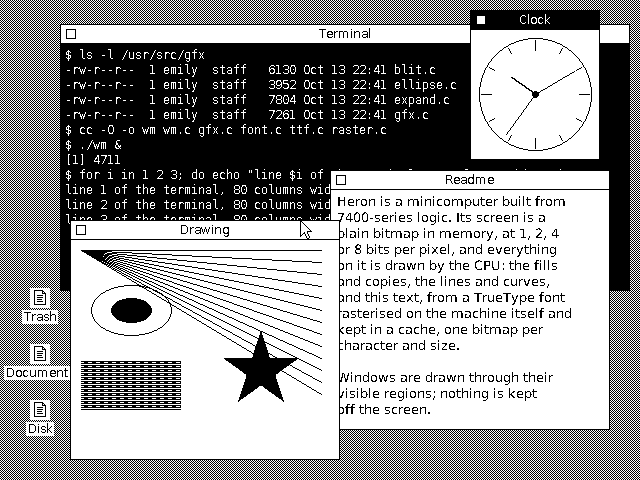
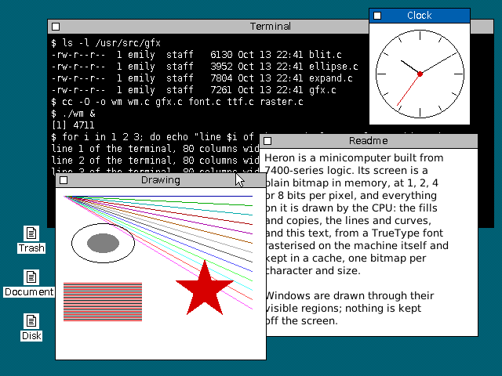
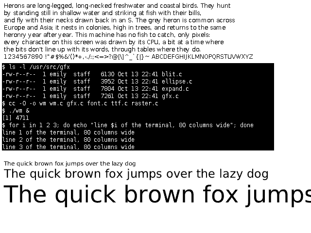

# Report 0019: Graphics on draft 1: a library, fonts and a window manager, 1a against 1b

How well drafts 1a and 1b suit graphics software. The graphics study
([studies/graphics](../studies/graphics/README.md)) has a graphics
library for screens of 1, 2, 4 and 8 bits per pixel, a bitmap and a
TrueType font renderer, and the graphics side of a window manager. They
are C, with their inner loops also written in assembly for each draft.
Three scenes exercise them, phase by phase, and every phase is costed
in the six configurations of the [draft 1 timing model](../studies/v1_isa/timing-model-v1.md).
The generated tables are in [performance.md](0019-report-graphics/performance.md).

**Short version.**

- **It works, at about the speed of a 1 MIPS machine with no help.** At
  3 MHz on the reference configuration (D16-overlap), with the assembly
  kernels on 1b:

  | | 1 bit per pixel | 8 bits per pixel |
  |---|---:|---:|
  | Fill | 1.7 MB/s (clear the 640 x 480 screen: 23 ms) | 2.4 MB/s (129 ms) |
  | Copy | 0.9 MB/s (scroll the screen: 41 ms) | 1.2 MB/s (242 ms) |
  | Text, bitmap font | 2,900 characters/s | 2,600 characters/s |
  | Text, TrueType from the cache, 12 px | 2,500 characters/s | 2,000 characters/s, anti-aliased |
  | Rasterise a TrueType glyph, 12 px | 13 ms | 24 ms, anti-aliased |
  | Move a window one step | 116 ms | 149 ms |
  | Scroll the terminal a line | 34 ms | 127 ms |
  | Repaint the whole screen | 423 ms | 561 ms |

  A 1-bit desktop is usable but sluggish: windows drag at 8 steps a
  second, the terminal scrolls 30 lines a second. At 8 bits, filling and
  copying the screen take 5–6 times as long and scrolling the terminal 4
  times; moving windows and repainting only 1.3 times, because most of
  their time goes on text, which costs about the same at every depth.
- **1b takes 4.6% fewer cycles than 1a** with the assembly kernels, and
  2.8% fewer as compiled C (geometric means over every phase and depth).
  - Its lead is in copies, where auto-increment carries the loop:
    copying a rectangle along its rows is 30% faster, scrolling 14–16%.
  - Anti-aliased text at 8 bits is 13–20% faster: `MOV r, byte [r]+` and
    `OR r, byte [ramp + r]` against three or four 1a instructions.
  - Everything else is within a few percent: the scan converter, the
    TrueType decoder, the window manager's bookkeeping and the
    kernels' set-up are compiled C, and the same in both.
- **The assembly kernels make the library 1.6–1.7 times faster** overall
  than the same library compiled, 3–6 times for copies, 3 times for text.
- **Shifts are the ISA's weak point for graphics.** Without a barrel
  shifter a shift costs a step per bit (and per byte and half), so
  everything below 8 bits per pixel pays for moving bits: a bit-aligned
  copy spends a third of its time shifting, lines at 1–4 bits cost twice
  what they do at 8, anti-aliasing at 2 and 4 bits twice what it does
  at 8.
- **What would help, in order:**
  1. **A load- and store-multiple through any register.** Emulated with
     `SAVE` and `RESTORE` through `sp`, it already makes clearing an
     8-bit screen 29% and scrolling it 22% faster; a real one would
     nearly halve copy loops (9.2 to 5.1 cycles a word).
  2. **A funnel shift** (`rd = (rd:rs) >> n`), or a barrel shifter: a
     bit-aligned copy word drops from 26.5 to 13.5 cycles. A barrel
     shifter alone saves 4.4% overall, and 25–34% of bit-aligned copies
     at 1 bit.
  3. **Auto-increment for 1a**, as [RFC 0004](0004-rfc-draft-1-isa.md#35-recommendations-for-draft-2)
     recommends: it is most of 1b's lead here too.
  4. **A merge under a mask** (`d = (d & ~m) | (c & m)`), the core of
     every masked edge and glyph word: 20% off the glyph loop.
- **The hardware matters more than either.** A 32-bit bus with the
  prefetch buffer (D32-wide) takes 0.67 of the reference's cycles; the
  draft 1b hardware's configuration (D32-separate) takes 1.03.

## What was built

| Part | What it does |
|---|---|
| Surfaces | Pixels of 1, 2, 4 or 8 bits, packed into rows of 32-bit words, the first pixel in the low bits; a clip rectangle |
| Fills | Rectangles in a colour or an 8 x 8 pattern, with COPY, XOR, OR and AND |
| Lines | Bresenham, clipped exactly: a clipped line has the pixels the whole line has |
| Ellipses | Outlined and filled, by Kennedy's integer algorithm, a span per row |
| Polygons | A scan converter for edges in 24.8 fixed point, even-odd or non-zero, with exact rational stepping (no division once an edge has started) |
| Anti-aliasing | The same scan converter with 4 sample rows and 16 steps across, accumulated as differences: four additions a span |
| Copies | Any rectangle to any place at the same depth, overlapping or not, any alignment |
| 1-bit images | Glyphs, icons and the cursor drawn in colour, transparent or opaque |
| Bitmap fonts | DejaVu Sans and Sans Mono at 12 px, rendered by FreeType with its hinting |
| TrueType | DejaVu Sans (cut down to ASCII) parsed on the machine: `cmap`, `loca`, `glyf`, `hmtx`; quadratic curves flattened by forward differences; glyphs rasterised plain or anti-aliased and cached |
| Window manager | Windows drawn through their visible regions (lists of rectangles), title bars, a desktop with a pattern and icons; moving, raising, closing and scrolling with as little drawing as possible; a cursor that keeps what's under it |

The window manager at 1 and 8 bits per pixel. The clock, the drawing
and the document (in TrueType, anti-aliased at 8 bits) are redrawn by
their own paint functions whenever part of them comes into view.

- **About 2,600 lines of C** in the library, fonts and window manager,
  550 in the scenes, and **about 1,100 lines of assembly per draft** for
  the kernels (1,218 in 1a, 1,112 in 1b), plus 170 for the
  store-multiple experiment.
- **The kernels** are the inner loops, written in C and in assembly for
  each draft: fills, spans, lines, copies, 1-bit expansion and
  anti-aliased coverage. The C library hands each a job, already clipped
  and worked out. The assembly uses the same algorithms as the C, except
  three tricks for the ISA's slow shifts ([below](#where-the-cycles-go)):
  the copy rotates each source word once instead of shifting it twice,
  the span takes its edge masks from tables, and the anti-aliased ramp
  at 2 and 4 bits rotates the destination word through the pixels.
- **Checking.** The same C built with gcc on the host prints a checksum of
  the screen after every phase. Every phase of every scene, at every
  depth, matches it on 1a and 1b, compiled C and with the assembly
  kernels. The kernels are also checked against pixel-at-a-time
  references at random sizes and alignments. In the window manager's
  scene, the screen after all the incremental updates is the same as a
  full repaint.
- **Measuring.** A scene calls `mark_n` at the end of each phase. That is
  a `HALT`, at which the harness reads the cycles in every configuration
  and the screen, then resumes. The bindings gained `Machine.resume` for
  this.

## How fast it is

All times at 3 MHz, as the draft 1 reports use. 1b with the assembly
kernels on D16-overlap unless said otherwise.

### Filling and copying

| | 1 bit | 2 bits | 4 bits | 8 bits |
|---|---:|---:|---:|---:|
| Fill, MB/s | 1.70 | 1.91 | 2.20 | 2.38 |
| Copy (scroll), MB/s | 0.90 | 1.06 | 1.17 | 1.23 |
| Fill, MB/s, D32-wide | 2.83 | 3.23 | 3.86 | 4.28 |
| Copy, MB/s, D32-wide | 1.36 | 1.62 | 1.79 | 1.89 |
| Clear the screen | 23 ms | 40 ms | 70 ms | 129 ms |
| Scroll it 16 rows | 41 ms | 70 ms | 127 ms | 242 ms |

- A whole word is 4.6 cycles to fill and 9.2 to copy in 1b's unrolled
  loops ([the inner loops](0019-report-graphics/performance.md#the-inner-loops-word-by-word)).
  The bandwidth grows with depth because the rows get longer and the
  per-row work is spread over more words.
- [RFC 0016](https://github.com/aiju/heron/pull/16) estimated 2 MB/s
  fills and 1 MB/s copies for the CPU; these are the same.
- Small things cost more per pixel: an 8 x 8 rectangle is 13–16 cycles a
  pixel, a 2 x 2 one 155. That is the C around the kernel (clipping,
  masks, the job), 600–900 cycles a call.
- A copy that isn't word-aligned at 1 bit per pixel costs 2.5 times an
  aligned one (1.5 cycles a pixel against 0.6), because each word is put
  together from two with shifts.

### Lines, ellipses and polygons

| | 1 bit | 8 bits |
|---|---:|---:|
| Line, cycles per pixel | 49 | 26 |
| Line, 1 to 20 pixels, cycles per pixel | 109 | 84 |
| Outlined ellipse, radii up to 205 | 37 ms | 39 ms |
| Filled ellipse, radii up to 50 | 6.5 ms | 7.9 ms |
| Star, 60–130 pixels across | 44 ms | 47 ms |

- **A line pixel is a read, a masked change and a write of a byte** below
  8 bits, and a byte store at 8, plus the decision. Horizontal and
  vertical lines through the line drawer cost the same per pixel; a
  library would send them to the fill, which is 50–100 times faster.
- **Ellipses and polygons are their spans.** A row of a filled ellipse
  is 250–300 cycles, three quarters of it in the span kernel (clipping,
  the masks from tables, the row's address with a multiply, then the
  words). A polygon's rows cost as much again in the scan converter,
  stepping and sorting the edges in C: half of a star's time.

### Text

| | 1 bit | 2 bits | 4 bits | 8 bits |
|---|---:|---:|---:|---:|
| Bitmap font, cycles a character | 1,049 | 1,195 | 1,079 | 1,139 |
| Terminal, an 80 x 25 page | 0.67 s | 0.80 s | 0.78 s | 0.87 s |
| TrueType 12 px, from the cache | 1,185 | 2,582 | 2,960 | 1,517 |
| TrueType 48 px, from the cache | 3,799 | 10,277 | 12,657 | 6,490 |

The TrueType text is plain at 1 bit and anti-aliased at the others.
Rasterising a glyph, which the cache does once per character and size:

| Size | Plain | Anti-aliased |
|---:|---:|---:|
| 12 px | 13 ms | 24 ms |
| 24 px | 18 ms | 40 ms |
| 48 px | 30 ms | 76 ms |

- **A bitmap glyph is about 1,100 cycles**: 57% in the kernel (a row is
  one load, a shift by the glyph's position in the word, then a table
  lookup per destination word), the rest in the C that sets each glyph
  up.
- **Filling a TrueType font's cache takes 1–2 seconds** per size (95
  glyphs at 13 px: 1.2 s plain, 2.2 s anti-aliased). After that, cached
  12 px text costs about what the bitmap font does, and 24 px text about
  twice that.
- **Anti-aliasing at 8 bits is a byte per pixel** through the ramp, about
  as fast as plain text. At 2 and 4 bits each pixel has to be put into
  its place in the word, which costs twice as much.

The text scene at 2 bits per pixel: the bitmap fonts, and DejaVu Sans
at 12, 24 and 48 px, rasterised on the machine and anti-aliased in four
greys. At 8 bits ([text-8.png](0019-report-graphics/text-8.png)) the
same text gets the palette's 24 greys.

### The window manager

| Operation | 1 bit | 2 bits | 4 bits | 8 bits |
|---|---:|---:|---:|---:|
| Move the top window one step | 116 ms | 131 ms | 163 ms | 149 ms |
| Drag an XOR outline one step | 14 ms | 15 ms | 15 ms | 16 ms |
| Raise a window | 98 ms | 84 ms | 85 ms | 82 ms |
| Scroll the terminal a line, on top | 34 ms | 50 ms | 75 ms | 127 ms |
| The same, half covered | 76 ms | 85 ms | 95 ms | 117 ms |
| Move the cursor | 3.8 ms | 3.9 ms | 4.1 ms | 4.6 ms |
| Repaint the whole screen | 423 ms | 650 ms | 739 ms | 561 ms |

- **Dragging outlines, not windows,** is what a machine this speed wants:
  an XOR outline moves at 60 steps a second, a window at 6–9.
- **A full repaint** at 1 bit is nearly half text and a sixth fills; the
  rest is lines, spans and the window manager's own work. At 8 bits the
  fills are a third (300 KB of stores) and text 40%. At 2 and 4 bits the
  anti-aliased document costs most ([below](#where-the-cycles-go)).
- **Moving a window** copies it (a third to a half of the time) and
  repaints what it uncovered, which is mostly drawing text again.
- **The cursor** is cheap at every depth: 12 x 19 pixels saved, restored
  and drawn with two masked expansions.

## 1a against 1b

Cycles, 1b / 1a (D16-overlap), geometric means:

| | Compiled C | Assembly kernels |
|---|---:|---:|
| Primitives | 0.967 | 0.939 |
| Text | 0.979 | 0.973 |
| Window manager | 0.973 | 0.957 |
| **All** | **0.972** | **0.954** |
| All, D32-separate | 0.958 | 0.944 |
| All, D32-wide | 0.964 | 0.945 |

(Geometric means over the phases at every depth;
[performance.md](0019-report-graphics/performance.md#1a-against-1b) has
them by scene and depth, and by phase.)
The gap is smaller than for the draft 1 programs (1b 7–10% faster,
[RFC 0004](0004-rfc-draft-1-isa.md)), because most of the
work here is either in kernels where 1b's modes help only a little, or
in compiled C, which gains less from 1b ([report 0011](0011-report-c-compiler.md)).

Where 1b gains, with the assembly kernels at 8 bits per pixel:

| Phase | 1b / 1a | Why |
|---|---:|---|
| Copy along the rows | 0.705 | moving right along its own rows, a copy runs backwards: `MOV r, -[r]` / `ST r, -[r]` against two `ADDI`s more a word in 1a. Forwards, 1a's unrolled loop is two instructions behind per four words |
| Anti-aliased text, cached | 0.80–0.87 | the ramp loop: `MOV r, byte [r]+`, `MOV r, byte [ramp + r]`, `ST r, byte [r]+` against `LDB`, `ADD`, `LDB`, `STB`, two `INC` |
| XOR fill | 0.856 | `MOV`, `XOR`, `ST [r]+` against `LD`, `XOR`, `ST`, `ADDI` |
| Horizontal lines | 0.850 | `ST r, byte [r]+` |
| Scrolling | 0.84–0.86 | auto-increment again |

Where they're the same: everything whose time is in compiled C (the
scan converter, the TrueType decoder, ellipses' arithmetic, the window
manager's regions), and the bitmap text, where 1a's one-parcel offsets
and loads that set the flags come out even with 1b's scaled index
(`LEA r, [table + r*8]`) and auto-increment.

What the kernels used, by draft:

- **1b:** auto-increment and pre-decrement everywhere; memory operands
  for the masked edges (`XOR r, [r]`), the pitches (`ADD r, [r1 + 8]`),
  frame variables (`AND r, [sp + 4]`) and the ramp (`OR r, byte [r + r]`);
  scaled indexing for every table; `CALL [sp + n]` and `JMP [r + r*4]`
  to pick the code for a depth.
- **1a:** one-parcel stores and loads at `[r + 4k]` for unrolled loops
  with one `ADDI`; `LSL` and `ADD` for table indexing (the `LSL #3` is
  three steps); loads that set the flags.
- **Both** ran short of registers in the copy and glyph kernels, and kept
  counters in a frame. 1b's one-parcel stack-slot operands make that
  cheaper.

## Compiled C against the kernels

The whole library, compiled, over the same library with the assembly
kernels (D16-overlap), from [performance.md](0019-report-graphics/performance.md#compiled-c-against-the-assembly-kernels):

| | 1a, 1 bit | 1a, 8 bits | 1b, 1 bit | 1b, 8 bits |
|---|---:|---:|---:|---:|
| Geometric mean over the phases | 1.60 | 1.68 | 1.61 | 1.72 |
| Copies | 2.2–4.3 | 2.7–5.3 | 2.4–4.9 | 3.1–6.1 |
| Bitmap text | 2.9–3.0 | 2.9–3.1 | 2.7–2.8 | 2.7–2.9 |

- The compiler's loops are correct and reasonable: it uses auto-increment
  and memory operands in 1b. What it can't do is what the kernels do by
  hand: unroll, keep everything in registers across a row, use rotations
  to avoid long shifts, and specialise per depth.
- Copies gain most: the C kernel checks per word what the assembly sorts
  out per row (which edge, whether it shifts).
- Where the time is outside the kernels (rasterising glyphs, polygons,
  the window manager's bookkeeping) the two are the same.

## Where the cycles go

**Shifts.** The model charges a shift by n one step per 16, per 8 and per
remaining bit; the draft 1b hardware is similar (2–11 cycles for a shift
by a constant, [report 0012](0012-report-draft-1b-hardware.md#4-datapath)). Graphics
shifts a lot:

- a copy that isn't word-aligned puts each word together from two
  source words, `(lo >> rs) | (hi << ls)`;
- a glyph row is shifted to its place in the destination word;
- a line steps a pixel mask, and below 8 bits each pixel is a bit field
  in a byte;
- anti-aliasing at 2 and 4 bits puts each pixel's value in its place in
  the word.

The kernels avoid long shifts where they can:

- **Rotate once, then merge.** A copy rotates each source word once by
  `rs`, and neighbouring rotated words are merged under a mask:
  `out = hi' ^ ((lo' ^ hi') & M)`. One shift a word instead of two.
- **Rotate the destination.** For anti-aliasing at 2 and 4 bits the
  destination word rotates by `bpp` a pixel at a time, so each pixel is
  at the bottom in turn, where it is replaced with `BIC` and `OR`. After
  32/bpp rotations the word is back in place. The C version builds the
  word from shifted values and a mask instead.
- **Shift the small way.** There is only `ROR`, and rotating right by 29
  is 7 steps where left by 3 would be 3. Glyph rows are shifted left by
  their lead pixels with `LSL`, and zero words are never shifted at all.
- **Tables.** Expanding 1-bit glyph rows into 2-, 4- and 8-bit pixels is
  a lookup per byte (`ZXB`, then an indexed load), in C and assembly
  alike; the assembly span kernel also looks up its edge masks instead of
  shifting by up to 31.

Even so, shifts are 12% of bitmap text at 1 bit, a quarter of
anti-aliased text at 4 bits and a third of a bit-aligned copy.
Re-costed with every shift one step (a barrel shifter), the phases take
0.956 of the cycles (geometric mean), and bit-aligned copies at 1 bit
0.66–0.75.

**Masked merges.** Every edge word and every glyph word is
`(d & ~m) | (c & m)`: `MOV`, `BIC`, `AND`, `OR`, `ST`, a third of the glyph
loop.

**Set-up in C.** Every primitive starts with clipping, a multiply for
the row's address (`y * pitch`; `MULS` by a 10-bit pitch is 21 cycles on
a 16-bit datapath), and the masks. That is about 900 cycles for a
rectangle and 450 for a glyph. Text and spans got fast paths in the
library for this reason. A pitch that is a power of two, as
[RFC 0016](https://github.com/aiju/heron/pull/16) proposes for the video
card, would turn the multiply into a shift.

**Pixel order.** The first pixel is in the low bits of a byte, so that a
little-endian word holds its pixels in order and can be shifted as one.
With the first pixel in the high bits, as the draft 1 `lines` program
has it, a word's bytes would be in the wrong order for that, and with no
byte swap instruction every copy and glyph would need one emulated.
This should be the hardware's order too.

## What would help

### A load- and store-multiple

`SAVE` and `RESTORE` already stream registers over the bus at one word
per bus transfer, but only through `sp`. The store-multiple experiment
([asm/v1b/stm](../studies/graphics/asm/v1b/stm/fill.s)) points `sp` into
the screen with interrupts off: `SAVE r1-r8` stores eight words, and a
copy alternates `RESTORE` from the source with `SAVE` to the
destination. Only long rows use it.

| | 2 bits | 4 bits | 8 bits |
|---|---:|---:|---:|
| Clear the screen | 0.91 | 0.79 | 0.71 |
| Fill a pattern | 0.90 | 0.80 | 0.71 |
| Scroll the screen | 0.93 | 0.84 | 0.78 |
| Scroll the terminal | 0.93 | 0.88 | 0.81 |
| Move a window | 1.00 | 1.00 | 0.93 |

(Cycles with the experiment over without, D16-overlap. At 1 bit the
rows are too short to pay for setting `sp` up.)

A real load- and store-multiple through any register, with writeback,
would need none of the juggling: a copied word would be 5.1 cycles
instead of 9.2 (6.6 with the emulation), and a filled one 2.9 instead of
4.6. On a microcoded machine it is the existing `SAVE` and `RESTORE`
sequences with the base register from the instruction instead of `sp`.
It's the 68000's `MOVEM` and ARM's `LDM`/`STM`, both used for exactly
this. It would help `memcpy` and context switches as much.

### A funnel shift, or a barrel shifter

| Loop, a word of a bit-aligned copy | D16-overlap | D32-separate |
|---|---:|---:|
| 1b today, shift 3 | 26.5 | 25.5 |
| 1b today, shift 29 | 34.5 | 29.5 |
| with a barrel shifter | 22.5 | 23.5 |
| with a funnel shift (`rd = rd:rs >> n`, one step) | 13.5 | 14.5 |

- **A funnel shift** takes two registers and a count (from a third
  register, or `HI`), and replaces a rotate and three logic operations.
  It needs a 64-to-32 shifter, so it comes with a barrel shifter.
- **A barrel shifter on its own** saves 4.4% over all the phases, 25–34%
  of bit-aligned copies at 1 bit, 16–19% of anti-aliased text at 4 bits.
  In 7400 logic a 32-bit one is about 40 multiplexer chips (five stages
  of 2 to 1, or three of 4 to 1), a real cost; the cheaper half step is
  the byte rotation the 1b datapath already has, plus a rotate by 0–7
  bits.
- **A rotate left**, or a shift that chooses the shorter direction, would
  avoid the 7-step `ROR #29`.

### Auto-increment for 1a

1b's lead in copies is auto-increment
([RFC 0004](0004-rfc-draft-1-isa.md#311-what-if-1a-had-auto-increment)
estimated it for the draft 1 programs). Here it is worth 30% on a copy
along its rows (`-[r]`, backwards) and 14–16% on scrolling. 1a with `[r]+` and `-[r]` for words
and bytes would close most of the gap to 1b in these kernels.

### A merge under a mask

`d = (d & ~m) | (c & m)` in one instruction would save two of the five
instructions per glyph word: 30.5 to 24.5 cycles for two words of glyph
pixels at 8 bits. It needs three operands; with the mask in `HI`, or a
fixed register, it would fit a two-operand format.

### Smaller things

- **A power-of-two pitch** for the screen (RFC 0016's 1024 bytes) turns
  `y * pitch` into a shift.
- **`ZXB` as a two-register unary** is already the best way to take a
  byte for a table index, in both drafts: one parcel, no constant.
- **1b's indexed mode** (`[r + r*8]`) saves the shift and add of every
  table lookup. Its 8-bit displacement can't hold a table address, so
  the table's address has to be in a register.
- **1b's `[r + 4]` costs an extension parcel**, where 1a has it in one;
  the glyph kernel uses `[r]+` and `ADD r, #4` instead.

### And the hardware

| Configuration, relative to D16-overlap | 1b | 1a |
|---|---:|---:|
| D16-separate | 1.20 | 1.22 |
| D32-separate (the draft 1b hardware) | 1.03 | 1.04 |
| D32-overlap | 0.82 | 0.81 |
| D32-wide | 0.67 | 0.68 |

A 32-bit bus with the prefetch buffer is worth more than everything
above put together: it makes every word load and store one bus transfer.
For a screen behind a card on the system bus, as RFC 0016 proposes,
reads would cost far more than here (about half a microsecond each), so
copies on the screen would be slower than these numbers, and a blitter
on the card would be worth correspondingly more.

## Notes from writing it

- **Both drafts were easy to write graphics for.** Every assembly kernel
  matched the C the first time it ran, in both drafts, against the
  scenes and the random checks. The work after that was all speed: the
  first glyph kernel was only 1.5 times the C, and four rounds of
  profiling (a funnel that rotated the long way, frame variables reread
  every row, the C around each glyph) took it to 3 times.
- **1b reads better in the copy loops**, `MOV r, [r]+` / `ST r, [r]+`, and
  its memory operands make the masked edges shorter. **1a reads better
  in tables and structures**: one-parcel `[r + 4k]` for every field of a
  job.
- **Registers ran out** in the copy and glyph kernels (14 is not many
  for a funnel shift with edge masks, counts and pointers), so both keep
  counters in a frame.
- **The `sp` trick** works because nothing else uses the stack while it
  runs: with interrupts on it would scribble on the screen. A real
  load- and store-multiple wouldn't have that problem.
- **`HALT` as a marker** for the harness needed one method in the
  bindings (`Machine.resume`); everything else came from the timing
  model as it was.

## Caveats

- **The cycles come from the timing model**, not hardware; the draft 1b
  hardware takes 0.91 of the model's cycles in its configuration
  ([report 0012](0012-report-draft-1b-hardware.md)). Both drafts are
  costed by the same rules.
- **The screen is in main memory**, written and read at RAM speed, as
  the brief allowed. A video card on the system bus would make reads
  slow and writes posted.
- **One writer wrote both drafts' kernels**, 1b first each time and then
  1a from it, in 1a's idioms (unrolled stores at short offsets, `LDB`
  setting the flags). Differences found while measuring were evened out
  both ways (pitches in registers in 1b, one-parcel addressing in 1b's
  glyph loop, a redundant `TST` in 1a's). The code is careful, not
  exhaustive: more unrolling, or kernels for more cases, would move the
  numbers by a few percent, in both drafts alike.
- **The C library is the same for both**, and so are its fast paths. The
  scan converter and the TrueType decoder are compiled C in every build.
- **The window manager has no backing store**, so anything uncovered is
  drawn again by its paint function; with memory to spare, a backing
  store for the top windows would make moving them a pair of copies.
- **The TrueType renderer has no hinting**, so small sizes are blurrier
  than FreeType's; the bitmap fonts are FreeType's hinted renderings.
