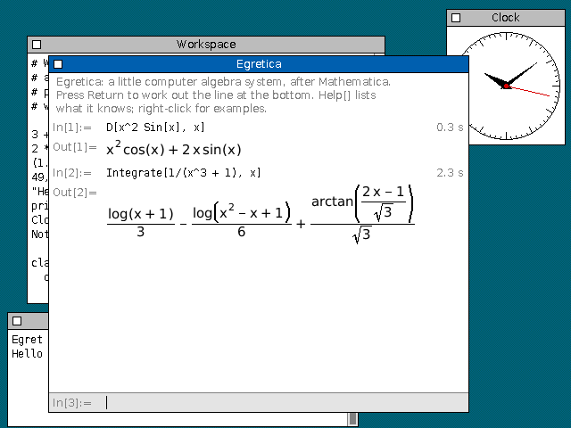
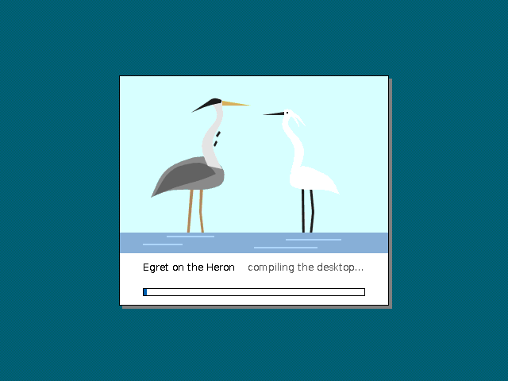
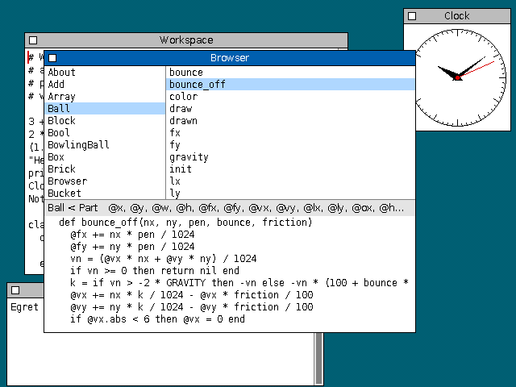
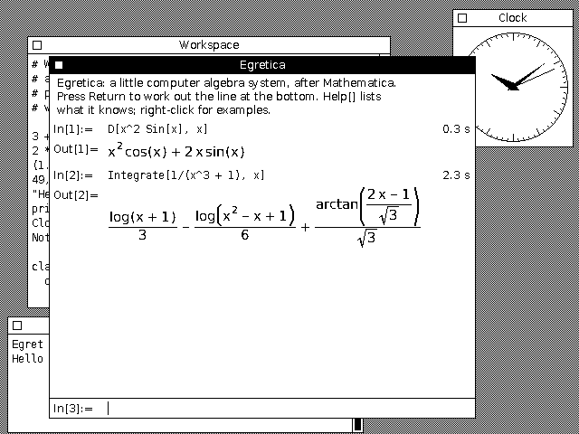
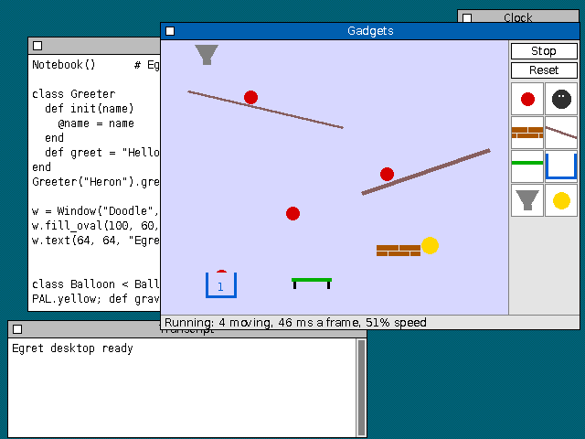
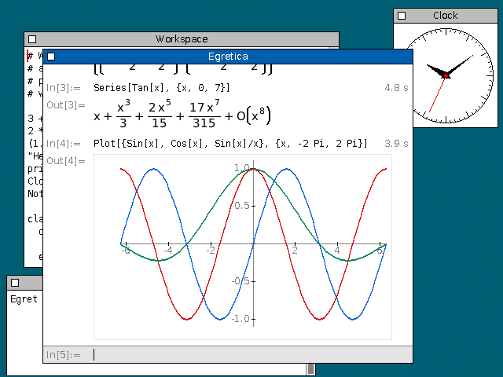

# Report 0021: A graphical desktop for Egret on draft 1b

A demo more than a measurement: a small Smalltalk-style desktop for
[Egret](0017-report-egret.md) on the simulated draft 1b machine, with
overlapping windows, a mouse, a keyboard, a Workspace to run Egret in, a
Transcript, a class browser, a clock, Gadgets, a playground of parts
with cartoon physics where a new class is a new part, and Egretica, a
little computer algebra system after Mathematica. The desktop is 7,700
lines of Egret (4,600 of them Egretica's) that the machine compiles as
it boots. The pixels are the
[graphics study](0019-report-graphics.md)'s library and kernels. It runs
in a browser as WebAssembly, at the machine's 3 MHz or faster
([studies/egret_gui](../studies/egret_gui/README.md)). The study's
generated tables are in
[performance.md](0021-report-egret-gui/performance.md), written by
`heron egret_gui bench --write`.

The desktop at 8 bits per pixel: the Workspace after three print-its and
a do-it, the Transcript with what was printed, Egretica with a
derivative and an integral, and the clock.

## Short version

- **It works, and at 3 MHz it's usable.** A keystroke in the Workspace
  takes 22 ms of the machine's time, printing `3 + 4 * 5` 59 ms (compiling
  it on the machine included), opening the menu 250 ms, dragging a window
  300 ms, and opening the Browser 0.9 s. Booting takes 61 s: 4 s to
  draw the splash and compile the prelude, 56 s to compile the
  desktop, 1.3 s to paint it. Gadgets'
  table runs at 25 frames a second of its 30, a frame with a few balls
  moving taking 37 ms. Egretica differentiates in under a second, and
  integrates, solves and factors in two or three. At 4× (12 MHz) it
  all feels quick.
- **Most of the time is Egret's, not the drawing's.** For small things,
  the interpreter takes half the cycles and drawing a tenth. Only the big
  repaints (opening the Browser: 30%) are much drawing, and that's text.
  An idle desktop costs 6% of the machine: its event loop's own work each
  tick, after cutting it from 11%.
- **The machine needed four things it didn't have.** A frame buffer, input
  as a queue of events, somewhere to sleep until the next tick (`HALT`
  and the timer, which it had), and memory: the VM, the graphics library
  and the fonts take 316 KB of the 1 MB before Egret has an object,
  Egret's heap shrank from two 256 KB semispaces to two 120 KB ones, and
  with Egretica the desktop's source no longer fits: it lives in VRAM.
- **The code passed 64 KB,** as far as a 16-bit relative call reaches.
  First the C library at the end went out of reach, then the VM's
  allocator from the interpreter, then the graphics library from the
  window manager. An order of linking where every call reaches fixed it
  here; a bigger program needs long calls or a smarter linker.
- **The simulator runs in a browser unchanged.** The Rust crate compiles to
  WebAssembly as it is, and runs at 55–65 MHz in Chromium (about 20 times
  the real machine), against 120–150 MHz natively.

## What was built

| Part | What it is | Size |
|---|---|---:|
| The devices | A frame buffer in 1 MB of VRAM outside RAM (640 × 480 at 1–8 bits per pixel, a 256-colour palette), a queue of input events, the mouse's position and buttons, the time of day, and the pointer's shape | 190 lines of Rust |
| The window manager | The graphics study's `wm.c`, reworked so that whatever of a window comes into view is erased and handed to Egret as an update, as on the classic Mac OS | 590 lines of C |
| Egret's primitives | Events, windows, drawing, offscreen layers, fonts, the Workspace's compiler, the Browser's view of classes and source | 1,080 lines of C |
| The desktop | Windows, menus, the event loop, a text editor (word wrap, a scroll bar), and the applications: Workspace, Transcript, Browser, Clock, About | 1,890 lines of Egret |
| Gadgets | Parts with cartoon physics on a table, after The Incredible Machine: balls, bricks, ramps, a trampoline, a bucket, a dropper; a bin of every subclass of `Part` | 1,160 lines of Egret |
| Egretica | A computer algebra system after Mathematica, in a notebook: exact arithmetic, derivatives, integrals, equations, factoring, series, sums, limits, numbers to any precision, matrices, plots; results laid out as maths | 4,640 lines of Egret |
| The browser version | The simulator as WebAssembly, a page that runs it by the clock, snapshots of the machine | 320 lines of Rust, 260 of JavaScript |

- **C does the pixels and the stacking.** It draws frames, title bars and
  the desktop, moves windows by copying them, and clips everything Egret
  draws to what's visible of its window. C never calls Egret; Egret pulls
  events, updates among them.
- **Egret does everything with behaviour:** which window gets a click, the
  dragging, the menus, and the applications. A Workspace's line is
  compiled by the compiler on the machine into a method, which the
  desktop then sends, so the code runs in the ordinary interpreter and its
  errors are Egret errors the desktop catches.
- **The Browser makes it a live system.** It lists classes and methods
  and shows a method's source, found from the line the compiler recorded.
  A double click opens a class or a method in a Workspace, where it can be
  changed and compiled again into the running desktop; objects that exist
  already use the new methods from their next send. The Browser keeps the
  source of what the Workspaces compiled, so a class shows its changes.
- **A cold boot has a splash.** Egret compiles a program whole before it
  runs any of it, so for the 56 s the desktop takes to compile, C draws
  a heron and an egret (450 bytes of vector paths, filled anti-aliased
  by the graphics study's scan converter, 2.2 s of drawing at 3 MHz),
  and the lexer moves a progress bar as it reads.

  

- **Idle costs the host nothing.** The desktop waits for the timer with
  `EI; HALT; DI`, and the simulator skips the cycles to the next tick.
  The browser counts cycles against the clock to run the machine at the
  speed chosen, programs its timer for 60 ticks a second at that speed
  (as a faster Heron would be), and shows how busy it is.

## How fast it is

At 3 MHz in the reference configuration (D16-overlap), less what the idle
loop would have spent in the same time (all of them in
[performance.md](0021-report-egret-gui/performance.md#the-desktops-costs)):

| | at 3 MHz |
|---|---:|
| Type a character in the Workspace | 21 ms |
| Return, with the lines below it redrawn | 193 ms |
| Print it: `3 + 4 * 5` | 61 ms |
| Print it: `2 ** 100` | 76 ms |
| Open the desktop menu and close it | 221 ms |
| Drag a window by 100 pixels and move it | 297 ms |
| Close a window, and paint the desktop under it | 112 ms |
| Open the Browser | 921 ms |
| Pick a method in the Browser and show its source (the first time: it indexes the source's lines) | 2,173 ms |
| A frame of Gadgets' table, with two to five balls moving | 37 ms |
| Open About (TrueType at 30 pixels, rasterised the first time) | 2,753 ms |
| Egretica: `D[x^2 Sin[x], x]`, worked out and drawn | 762 ms |
| Egretica: `Integrate[1/(x^3 + 1), x]` | 3,031 ms |
| Boot: the splash, the prelude, the desktop's 7,700 lines, the first paint | 61.4 s |

- **The first second is the budget.** Typing keeps up with a fast typist;
  everything that redraws a window's worth of text takes a few hundred
  milliseconds, the speed of the graphics study's text (2,600 characters
  a second). A desktop of this kind on a 3 MHz Heron would feel like an
  early Macintosh, slower where it draws text in colour.
- **Long computations need to share.** Without processes, Gadgets works
  a frame at a time from the timer's tick, so the desktop stays usable
  while it runs. Egretica doesn't: while it works a line out (a second or
  two, a minute to factor 2^64 + 1) the desktop waits, with a busy
  pointer, as it does for a Workspace line. A loop that never returns in
  a Workspace hangs it.

## Gadgets

Gadgets is the demo for live coding. Every part is an object of a
subclass of `Part`, which draws it, finds the balls that touch it and
says what they do (a trampoline sends a ball up as high every time; a
bucket counts what falls in), and the bin holds every such class. So
the Workspace changes the physics as it runs: a new colour, a lower
gravity or a bouncier ball takes effect from the next frame, and a new
class (above, a `Balloon` with negative gravity, five lines) is a new
part in the bin.

- **A ball costs about 45,000 cycles a frame:** some 20,000 of physics
  (its step, the still parts near it, found through a grid, and the other
  balls) and 25,000 of drawing it. So at 3 MHz the table keeps up with
  three or four balls, and slows down past that; a late frame is done
  with the next and drawn once for both.
- **Calling a primitive costs 2,000 to 3,000 cycles before it draws
  anything** (a 1 × 1 fill takes 2,400), so drawing is counted in calls,
  not pixels: a ball is an oval and two copies. The first version
  searched the palette for every `PAL.rgb` (45% of a frame) and drew the
  ramps under a moving ball again every frame (a polygon, 34,000
  cycles).
- **It draws offscreen.** VRAM past the screen holds two layers of the
  table: the parts that stay still, and the picture. A ball is rubbed
  out by copying from the first to the second, drawn there, and the
  rectangle copied to the screen, so nothing is drawn twice and the
  screen never shows a ball half drawn. The window is kept on a word
  boundary of the screen, as the Macintosh kept its windows: otherwise
  every word of a copy is shifted, and a shift takes a step per bit.

## Egretica

Egretica is the demo for what an interpreter on a slow machine can do
with exact arithmetic. It's a notebook: a line typed at the bottom, in a
little of Mathematica's language (`Integrate[x^2 Exp[x], x]`,
`Solve[x^2 - x - 1 == 0, x]`, `Plot[{Sin[x], Cos[x]}, {x, 0, 2 Pi}]`),
comes back above it laid out as maths, or as a plot.

| | at 3 MHz |
|---|---:|
| `D[x^2 Sin[x], x]` | 762 ms |
| `Integrate[x^2 Exp[x], x]` | 2,032 ms |
| `Integrate[1/(x^3 + 1), x]` | 3,031 ms |
| `Solve[x^3 - 6 x^2 + 11 x - 6 == 0, x]` | 1,731 ms |
| `Factor[x^6 - 1]` | 1,678 ms |
| `Series[Tan[x], {x, 0, 7}]` | 5,358 ms |
| `N[Pi, 50]` | 1,024 ms |
| `Plot[{Sin[x], Cos[x]}, {x, 0, 2 Pi}]` | 4,700 ms |

(Each worked out and drawn, in a notebook with the lines before it.)

- **Big integers make exact algebra easy to write.** Egret's integers are
  any size, so fractions are pairs of them, and `sqrt(12)` is
  `2 sqrt(3)` by trial division. The algebra is expressions that put
  themselves in a canonical form as they're made (terms sorted by a key
  string, like terms collected), so that equal expressions have equal
  keys; derivatives are the rules, and integrals a few methods tried in
  turn (a table, partial fractions, substitution, by parts). The tests
  check 28 integrals by differentiating them; a check against SymPy
  while it was written passed 79 of 80 (the last, e^(x^2), has no
  elementary integral).
- **There's no floating point, and no need of it.** Approximate numbers
  are fixed point in big integers: `N[Pi, 50]` is Machin's formula at
  190 bits, and the functions are their series after reducing the
  argument. Plots use the same at 12 bits, which keeps the arithmetic
  in small integers.
- **The cost is the interpreter's.** Once the fonts are rasterised, the
  drawing is a tenth of a result's time or less; the rest is sends,
  allocating, and collecting. The first result drawn used to cost 2.5 s
  more, rasterising the glyphs and searching the palette 65 times for the
  shades between black and white, so the desktop does that as it boots.
- **It's most of the memory.** Egretica's 4,600 lines take 170 KB of
  permanent space, 1.4 bytes for each byte of source, comments
  included. With Gadgets too, the desktop's source (200 KB) left no room
  in RAM for both itself and what it compiles to, so it moved to VRAM,
  past Gadgets' layers, and the C stack went from 72 KB to 24 KB (it
  never goes past 3 KB). Life, the Mandelbrot set and Paint went to make
  room.
- **The font has only ASCII,** so pi, the integral sign, arrows, the
  minus and times signs, and brackets taller than a line are drawn with
  lines and fills, which at 15 pixels look like the font's own, near
  enough.

## Where the cycles go

By the kind of function, everything from the event to the end of a short
wait after it, idle loop included:

| | an idle second | a keystroke | print it | open the Browser |
|---|---:|---:|---:|---:|
| Egret's interpreter (the assembly loop) | 69% | 56% | 32% | 48% |
| its slow path, in C | 0% | 10% | 7% | 4% |
| allocation and collection | 13% | 8% | 5% | 6% |
| drawing (the graphics library) | 0% | 10% | 35% | 30% |
| the window manager | 6% | 4% | 2% | 2% |
| Egret's primitives | 10% | 7% | 4% | 4% |
| the rest of the VM and the C library | 1% | 5% | 16% | 7% |

- **GUI code is made of small objects.** Points, rectangles and events are
  lists, and a list literal, string interpolation, `try` and `for` all go
  to the interpreter's slow path in C ([report 0017](0017-report-egret.md)
  measured the interpreter on programs that hardly use them). Faster paths
  for those in the VM would help GUI code more than any instruction.
- **The idle loop is software.** A tick with nothing to do took 5,600
  cycles at first: building the mouse's position and a hit test as lists,
  and working out the pointer's shape, every tick. Doing that only when
  the mouse has moved brought it to 3,100 cycles, 6% of the machine.
- **Print it is the compiler as much as the code.** A Workspace line goes
  through the same compiler as a program (16% of the cycles are the rest
  of the VM, mostly the compiler and, for `2 ** 100`, big integers), then
  the result is drawn into the line.

## What it says about the machine

- **Memory is the first limit.** The VM, the graphics library and kernels
  and the fonts are 316 KB, against 140 KB for Egret alone. Egret's map had
  to move up (the permanent space from 0x50000 instead of 0x38000), its
  semispaces to shrink to 120 KB, and the console input, the desktop's
  source, to go to VRAM. After booting, the desktop uses 331 KB of its
  368 KB of permanent space and 50 KB of heap; every Workspace line done
  adds a method that's never collected, and running out of permanent
  space stops the machine. A desktop on the real machine wants 2 MB or
  more.
- **A separate frame buffer suits it,** as [RFC 0016](0016-rfc-video.md)
  recommends: the screen takes none of the RAM. Here the VRAM past the
  screen also holds the font cache, what's under a menu, Gadgets'
  layers and the desktop's source, which is a hack: real VRAM reads are slow ([RFC 0016, section 4.5](0016-rfc-video.md#45-how-the-cpu-reaches-it)).
  Copies within VRAM, which Gadgets lives on, are what a blitter on the
  card would do.
- **The pointer is drawn by the browser,** like a hardware cursor, which
  RFC 0016 doesn't recommend. It saved the window manager from hiding a
  software cursor around everything it draws. That bookkeeping, not the
  drawing, is the case for a hardware cursor.
- **Input as a queue of events,** with the buttons' state readable too,
  was all the desktop needed. Since the machine can be busy for a while,
  a click is acted on where it happened, not where the mouse is when the
  machine gets to it; events carry their position, but not their time,
  so a double click is timed from when the first click was dealt with.
- **16-bit relative calls reach 64 KB.** The linker puts the C library
  after everything else, and once the code passed 64 KB, early callers of
  `memset` couldn't reach it. The workaround was to link the library in
  the middle; a real system would want the compiler to use 32-bit calls
  where needed, as it already does for far data.

## Caveats

- **It's a demo.** The display, keyboard and mouse, and Egret's hooks for
  this build, are hacks outside the study, listed in its
  [README](../studies/egret_gui/README.md#before-a-pr), to be done properly
  or taken out before anything is merged.
- **The times are the reference configuration's,** like the other draft 1
  reports; the draft 1b hardware's configuration (D32-separate) takes 5%
  more cycles to boot the desktop, and D32-wide 31% fewer.
- **Cycles spent waiting on VRAM aren't counted.** The simulator gives VRAM
  the same timing as RAM; on a real video card, reads would be slower.
