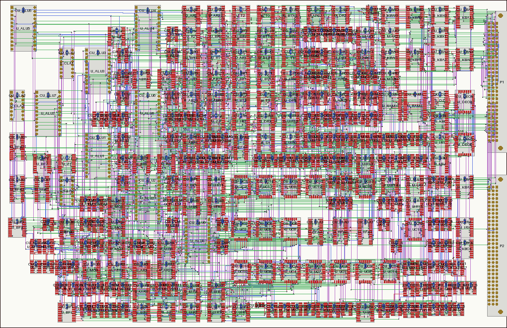
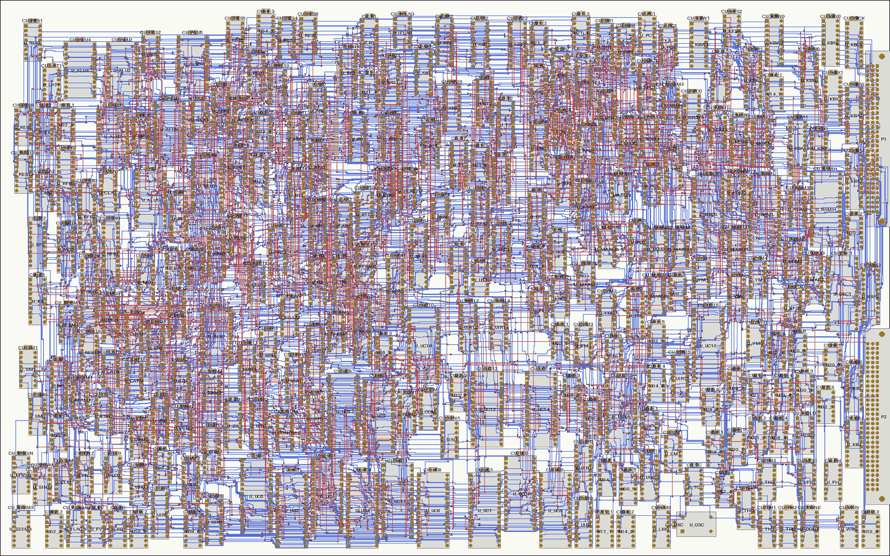

# RFC 0023: Printed circuit boards: a flow from the netlist to checked boards

## Contents

1. [Summary](#1-summary)
2. [How Claude can design a board](#2-how-claude-can-design-a-board)
3. [KiCad, our own tools, or something else](#3-kicad-our-own-tools-or-something-else)
4. [The flow](#4-the-flow)
5. [Making sure the board is the simulated netlist](#5-making-sure-the-board-is-the-simulated-netlist)
6. [The CPU card: size, layers, SMD or DIP](#6-the-cpu-card-size-layers-smd-or-dip)
7. [What the board says about the design](#7-what-the-board-says-about-the-design)
8. [Limits and what's next](#8-limits-and-whats-next)
9. [Open questions](#9-open-questions)

The numbers are in [results.md](0023-rfc-pcb-flow/results.md), which
`heron pcb sweep --write` generates; the code is `infra/pcb`,
`infra/pcbroute` and [studies/pcb](../studies/pcb/README.md).

## 1. Summary

**Recommended:** a flow of our own, from the netlist the simulator runs to
a KiCad board, with KiCad for what it does best (its libraries, its design
rule check, its plane filler, its Gerber writer, a GUI to look and
touch up); four checks, independent of each other, that the board is that
netlist; and the board's wire delays back in the simulator.

| Step | How | Where |
|---|---|---|
| **The source** | The Python netlist the chip-level simulator runs. Nothing about connectivity is ever edited on the board | `infra/hw/netlist.py`, the studies |
| **Packages and pinouts** | A table per chip type, checked against KiCad's symbol library; footprints from KiCad's library | `infra/pcb/packages.py` |
| **Parts** | Every chip with its supply pins, a decoupling capacitor each, the connectors by the bus's pin map | `infra/pcb/physical.py` |
| **Placement** | The chips in rows and columns, all the same way round, as on the classic TTL boards: quadratic placement, then each chip onto the grid, annealing on wire length with the timing-critical nets weighted; capacitors under each chip | `infra/pcb/place.py` |
| **Routing** | Our own grid router (negotiated congestion), in Rust: the whole CPU card in under a minute | `infra/pcbroute` |
| **The board file** | Written directly as KiCad 9 s-expressions, with a project file holding the design rules | `infra/pcb/board.py` |
| **Checks** | Pinouts against KiCad's symbols; pads against the netlist; copper connectivity from geometry, and KiCad's DRC; the fab's test netlist against the board | `infra/pcb/check.py`, `copper.py` |
| **Timing** | The routed wires' delays back into the chip-level simulator and the static timing analysis, each load with its own flight time | `infra/pcb/wires.py`; per-pin delays and the `wire` fixture in hwsim and `sta.py` |
| **Fab files** | Gerbers, drill, placement and the IPC-D-356 test netlist, by `kicad-cli` | `studies/pcb/flow.py` |

**For the CPU card** (269 chips): surface-mount parts on a grid, rows and
columns of chips all the same way round, **six layers, about 340 × 220
mm**, the decoupling capacitors underneath. It places and routes in under
a minute each, with no DRC errors, and every check passes. Placed freely
it would be 300 × 220: the grid costs 10–13% more area. On four layers
it routes only placed freely, at 460 × 260. The plain DIP version works as a grid on
**four layers at about 480 × 340 mm**, 2.2 times the area, or on six at
420 × 302. One card is enough: splitting the CPU over two would put about
170 signals or more between them.

**The finding that matters most:** a board changes the timing, and the
flow has to put that back into the simulation. With the routed CPU card's
wire delays in hwsim, the machine that passes every test with ideal wires
gets hundreds of setup violations from flight times alone, and **goes
wrong** once the loads are in: its clock is one 74F175 output driving 53
inputs over 1.25 m of copper, 364 pF, 16 to 21 ns late. With a clock tree
for CLK, the length classes worked out again by the static timing
analysis with the board's delays, and placement that keeps the 50 MHz
clock generator together, **the simulation with the board's wires runs
with no violations**, about 4% slower than with ideal wires (section 7).

## 2. How Claude can design a board

PCB design tools are made for a person at a screen: drag parts, watch the
ratsnest, push tracks. Claude can't use them that way, and shouldn't
try. What it can do well:

- **write programs** that produce the board, from a description it can
  read and change: the netlist is already one;
- **read files and numbers**: a board file is text, a DRC report is JSON;
- **look at pictures**: the flow renders every board as a PNG
  (`board.png`), and Claude can read images. That is how the placements
  here were reviewed;
- **run checks** and act on what they say.

So the board must come out of code, end to end, with every judgement
written down as a rule (where the capacitors go, which side the connector
is on) and every result checked by a program. A person then reviews the
picture, opens the board in KiCad if they like, and can touch up anything
that doesn't change connectivity (silkscreen, a track's shape). That is
also what makes the board reproducible: rebuild it after a netlist change
and it comes out checked again.

That is how this RFC was made: the code was written by Claude in one
session, and every board in its tables was produced, looked at and
checked without a person in the loop.

## 3. KiCad, our own tools, or something else

The pieces of a PCB flow, and who should do each:

| Piece | Choice | Why |
|---|---|---|
| Netlist | **Ours** (`infra/hw`) | It exists and the simulator runs it. A schematic would be a second source to keep in step |
| Footprints | **KiCad's library** | Thousands of IPC-7351 footprints with 3D models, maintained. Writing our own is easy to get subtly wrong (paste, courtyards) |
| Pinouts | **Ours, checked against KiCad's symbols** | Our chips' pin names are the simulator's; the check found a real error (section 5) |
| Placement | **Ours** | Nothing headless and scriptable does it well. The problem is small enough (270 parts) for textbook methods |
| Routing | **Ours** | Freerouting, the open alternative, did not finish (below) |
| Board file | **KiCad's format, written directly** | Text, stable, documented, and every fab and tool reads what KiCad writes. No dependency on KiCad's Python API to write it |
| DRC, plane fill, Gerbers | **KiCad** (`kicad-cli`, its `pcbnew` module) | Mature, independent of our code, and the fab's tooling expects its output |
| Viewing and touch-ups | **KiCad's GUI** | For a person |

**KiCad's own scripting** was not used for the core of the flow:

- the SWIG Python module (`pcbnew`) is deprecated since KiCad 9 and due to
  go; the flow only uses it to fill the planes before the copper check;
- its new IPC API needs a running KiCad GUI in KiCad 9 and 10;
- its file format is the stable interface: KiCad reads old files forever.

**Freerouting**, the open-source autorouter KiCad users reach for (Java,
Specctra DSN in, SES out; `infra/pcb/dsn.py` writes and reads both),
was run on the CPU card placed freely at 340 × 220:

- with the planes given to it as power layers, as KiCad exports them, its
  first fanout pass took **101 minutes and escaped 134 of 3,508 pins**; it
  was stopped at two hours without a result;
- with only the signal layers given to it and its fanout off, it had not
  finished its first routing pass after an hour, and gave nothing back.

**Our router** routes the same board in under a minute. It is a grid
router with negotiated congestion (PathFinder, the algorithm of FPGA
routers): every net is routed alone, nodes shared by two nets cost more
in each round, and nodes that stay contested build up a history cost,
until no node is shared. The grid's pitch is a track's width plus the
clearance (0.254 mm), so tracks of different nets may use neighbouring
grid lines; a via keeps other nets out of the nodes around it on every
layer; a multi-pin net grows as a tree, A* from the tree to the nearest
pad not yet reached. It is about 850 lines of Rust, and the things that
made it fast were the ones every router book lists: the heuristic must
count the via still to come, and a multi-pin net must aim at one pad at a
time, not at all of them.

**Other things considered:**

- **atopile, SKiDL:** languages that describe a circuit and hand it to
  KiCad, where a person places and routes. Our netlist language already
  does the describing; the placing and routing is what we need.
- **tscircuit:** circuits as TypeScript/React with its own autorouter. A
  third language, and a young router.
- **Horizon EDA, LibrePCB:** GUI tools, fine for a person.
- **Commercial AI placers and routers** (Quilter, DeepPCB, Cadence's):
  cloud services, paid, and not reproducible from the repository.
- **Entirely our own, Gerbers included:** possible (Gerber is simple), but
  it would throw away KiCad's footprints, DRC and viewer for nothing.

## 4. The flow

```sh
heron pcb build cpu --size 340x233.35 # place, route, check: build/pcb/<name>/
heron pcb check board.kicad_pcb        # check a board file against the netlist
heron pcb view                         # the boards as a web page: pan, zoom, layers, nets
heron pcb pinouts                      # the pinouts against KiCad's symbols
heron pcb sweep --write                # the experiments behind this RFC
```

One build, for the CPU card at 340 × 220 mm:

1. **Parts** (`physical.parts`): the card's netlist (`studies/v1b_system`)
   through the pinout table. Each chip keeps the simulator's reference
   (`U_ALU3`), so a board's part and the simulator's chip are the same
   name. Tied pins (a clock driver's enables, the supervisor's capacitor
   pins) get their rail or a capacitor; the connectors' pads get their bus
   signals by report 0022's reference pin map. The card gets its mechanics
   by the design rules of [RFC 0026](0026-rfc-pcb-design-rules.md)
   (`cards.mechanics`): keep-out strips along the edges, the connectors at
   the Eurocard positions, the front panel's bracket holes, fiducials.
2. **Placement** (`place.GridPlacer`): the chips in rows and columns, all
   the same way round (pin 1 at the top left), as on the classic TTL
   boards. The board is a grid of slots, at least 8.25 × 14.25 mm and
   stretched to fill it: a narrow SOIC takes one, a wide one two side by
   side, the PLCCs and the tall parts two rows, and a block of two starts
   on an even column or row, so a wide chip takes the place of two narrow
   ones and the columns line up. Quadratic placement, with the connectors
   as anchors and spread by recursive bisection to the board's density,
   gives each chip a target; each chip, largest first, goes to the free
   block nearest it; then annealing swaps chips whose blocks are the same
   size or moves one to a free block nearby. Nets of the 50 MHz clock
   generator weigh eight times as much, so its chips stay together. Then
   each chip's 100 nF goes under it on the bottom, between its pin rows,
   as near its supply pin as its vias can go clear of the pads.

   `place.Placer` (`--free`) puts the parts anywhere instead: each to the
   nearest free spot on a fine grid, turned by 180° where that shortens
   the wires. It packs a little tighter (section 6), but the chips end up
   at any position and either way round.
3. **Fanout** (`fanout.fanout`): every surface pad on a supply gets a via
   at its inner end, under the chip's body, where it can't meet a
   neighbour's (beyond its outer end where the body is crowded); the
   planes do the rest. The router never sees the supplies.
4. **Routing** (`router.route`): the grid router on the four signal layers
   (top and bottom any way, the inner two horizontal and vertical).
5. **The board file**: KiCad 9 format, a project file with the rules (the
   standard six-layer process of a common fab: 0.127 mm tracks and gaps,
   0.2 mm holes in 0.45 mm vias), and a PNG.
6. **Checks** (section 5), and the fab files. `heron pcb view` writes the
   boards as one web page to look at them by layer and by net.

The stackup is signal, ground, signal, signal, power, signal: each signal
layer next to a plane, the two inner signal layers crossing at right
angles.

**What it takes:** under a minute to place, under a minute to route, and
a few minutes to check (most of it KiCad's plane filler and DRC). Boards
are build output, not committed: a routed board is 24 MB of KiCad's text,
and it comes back in two minutes.

## 5. Making sure the board is the simulated netlist

The chain from the simulator to the fab has five links. Each is checked
by code, and the important ones by two programs that don't share code.

| Link | Check | Independent of |
|---|---|---|
| 1. The simulator's logical pins → package pins | `heron pcb pinouts`: every pinout against KiCad's symbol library | our pinout table: KiCad's librarians transcribed the same datasheets |
| 2. The netlist → the board's pads | `check.compare`: the board file read back, its pads' nets against the netlist through the pinouts, as partitions (names don't matter) | the code that built the board |
| 3. The pads' nets → the copper | `copper.check`: connectivity from the copper's geometry alone (tracks, vias, pads, the filled planes); and KiCad's DRC (`unconnected`, `shorting_items`) | each other, and the router |
| 4. The board → the fab | `check.compare_ipc356`: the IPC-D-356 netlist the fab tests the bare boards against, matched to pads by position | KiCad's net labels |
| 5. The board's wires → the timing | `wires.nets`: each net's copper as a graph, the flight time to each load and the load in pF, back into hwsim and the timing analysis: the driver's delay, and in front of each load further along a wire element with its own flight time | — (section 7) |

**What each link caught while this was being built:**

- **Pinouts:** the TL7705A's active-low RESET is pin 5, not 6. KiCad's
  library had it right. The 42 pinouts KiCad has symbols for now all
  agree; the 74ABT823 and the CDC341, which it lacks, were checked against
  TI's datasheets by hand (the other two are an oscillator and a resistor
  network).
- **Copper:** the router ended a track in the corner of the oscillator's
  rounded pad, where there is no copper. KiCad's DRC reported it; our
  copper check didn't, because it shared the router's model of a pad as a
  sharp rectangle. Both now model rounded rectangles exactly, and agree.
  That is why link 3 has two checkers.
- **The fab's netlist:** KiCad truncates references to six characters in
  IPC-D-356 (`U_UIR15` becomes `U_UIR1`), so it is matched by position.
- **Placement**, through KiCad's DRC: power vias of two neighbouring chips
  whose supply pads faced each other, a capacitor with no room beside a
  chip too small to have it underneath, and capacitors at the wrong end
  of chips with an input tied to VCC (taken for the supply pin). Each is
  now a rule in the placer, and the DRC is part of every full check.
- **Timing**, through the simulation with the board's wires: the first
  grid placement missed a setup time on the microcode register by 1.6 ns
  (better annealing fixed it). And it showed the wire model too
  pessimistic: when every load got its net's worst flight time, the bus
  hold flip-flop missed its setup by 0.6 ns because the bus clock's wire
  goes on to the connector, 1.4 ns away, while the gate in front of the
  flip-flop is 0.6 ns along it. Each load now gets its own.

**The rules that keep it true:**

- **One source.** Anything that changes connectivity (a gate swapped to
  another package, pins swapped for routing, an address line moved) is a
  change to the netlist's Python, so the simulator runs it. The board is
  regenerated; `compare` fails on a board whose connectivity was edited
  by hand.
- **Parts the simulator doesn't have** are allowed only by rule: a
  decoupling capacitor `C<chip>` from VCC to GND, a tied pin's capacitor
  `C<chip>.<pin>`, the connectors by their pin map. Anything else fails.
- **The checks are tests:** `heron test pcb` builds a small board and
  checks that each check catches a swapped pin, an extra part, an open
  and a short. With KiCad's libraries in CI, it could also rebuild and
  check the CPU card on every change to its netlist (about four minutes).

## 6. The CPU card: size, layers, SMD or DIP

Every board in [results.md](0023-rfc-pcb-flow/results.md), built by
`heron pcb sweep`; "routed" means no net left in conflict and no
difference from the netlist, and the boards marked ✓ also pass the copper
check, KiCad's DRC and the fab netlist's check.

| Board | Layers | Size (mm) | Result |
|---|---|---|---|
| **SMD, grid**, capacitors under | 6 | **340 × 220** | **routed ✓** |
| | 6 | 330 × 220 | routed |
| | 6 | 320 × 220 | routed, in the last of 60 rounds |
| | 6 | 300 × 220 | the parts don't fit |
| SMD, grid | 4 | 480 × 260 | **not routed** (60 nets in conflict) |
| **DIP, grid** | 6 | **420 × 302** | **routed ✓** |
| | 6 | 400 × 302 | the parts don't fit |
| | 4 | **480 × 340** | **routed ✓** |
| | 4 | 480 × 320, rows of 31 mm | routed |
| | 4 | 440 × 302, the six-layer slots | not routed (17 nets in conflict) |
| SMD, free, capacitors under | 6 | 380 × 220 | routed ✓ |
| | 6 | 340 × 220 | routed |
| | 6 | 300 × 220 | routed ✓ |
| | 6 | 280 × 233 (6U × 280) | routed |
| | 6 | 280 × 220 | routed, in twice the rounds |
| | 6 | 260 × 220 | the parts don't fit |
| SMD, free, everything on top | 6 | 340 × 220 | routed |
| | 6 | 320 × 220 | the parts don't fit |
| SMD, free, parts on both sides | 6 | 280 × 220 | routed |
| | 6 | 260 × 220 | not routed (2 nets in conflict) |
| SMD, free | 4 | 380 × 220 | not routed (58 nets in conflict) |
| | 4 | 440 × 260 | not routed (2 nets in conflict) |
| | 4 | 460 × 260 | routed ✓ |
| DIP, free | 6 | 480 × 300 | routed ✓ |
| | 6 | 440 × 300 | the parts don't fit |
| | 4 | 480 × 300 | routed ✓ |
| | 4 | 520 × 300 | routed |

From these:

- **SMD on six layers, as a grid: about 340 × 220 mm** (75,000 mm²);
  330 × 220 routes as easily, 320 × 220 only just. Placed freely the card
  gets down to 300 × 220 (66,000 mm²), so the grid costs 10–13% of the
  area: a narrow SOIC's slot is as tall as a wide one's, and a wide SOIC
  takes two narrow slots. Four signal layers carry about 110 m of track.
- **SMD on four layers** routes only placed freely, at about 460 × 260
  (120,000 mm²): 1.6 times the area of the six-layer grid, on two signal
  layers, one of them covered in pads. The grid doesn't route on four
  layers at any size tried (section 8).
- **DIP packs better on the grid than placed freely.** All the 0.3"
  DIPs are the same width, so the slots waste nothing across them. On six
  layers the grid gets to 420 × 302 (127,000 mm²), smaller than any free
  DIP board. On four layers its slots need to be wider and taller (12.07
  × 33 mm, against 10.75 × 29.5) to leave the two signal layers room
  between the chips: 480 × 340 (163,000 mm²), and 480 × 320 routes too,
  against 480 × 300 placed freely. So Emily's original plan, a plain DIP
  board on four layers, works as a grid; it is just big: 2.2 times the
  SMD card's area.
- **One card is enough.** RFC 0005 expected the CPU to need two. Splitting
  it would be costly: the best two-way split found cuts 171 signals,
  control against datapath 201, and the backplane has about 52 spare pins
  per slot.
- **The card's height** comes from its connectors: P1 and P2 are 95 mm
  each, so 220 mm is about the least for both. The depth follows from the
  area. That needn't be a Eurocard size, but 6U (233.35 mm) by 280 mm,
  a standard subrack depth, routes placed freely; the grid's equivalent
  would be about 6U × 320 (not tried).
- **Parts on both sides** save little, and only placed freely (the grid is
  one-sided): 280 × 220 against 300 × 220, for a second side of chips to
  assemble. The capacitors underneath already need a second side, but one
  of only capacitors, which a fab charges less for; with everything on
  top the free card grows to about 340 × 220.



*The SMD card at 340 × 220 mm, its chips on a grid. Red: top-side pads
and tracks; green and purple: the inner signal layers, horizontal and
vertical; blue: the bottom, with the decoupling capacitors under the
chips; grey dots: vias. A detail at full scale:
[smd-detail.png](0023-rfc-pcb-flow/smd-detail.png).*



*The DIP card at 480 × 340 mm, on four layers, its chips on a grid with
each capacitor above its chip: red, the top's tracks; blue, the bottom's;
the planes are the two inner layers.*

**Packages:** 74-series logic in SOIC (all of it is made in SOIC, and it
is easy to rework); the microcode flash in PLCC-32, which can go in a
socket to be reprogrammed; the 74LS181 and 74S182, which are only
new-old-stock, in DIP; the fast SRAMs in SOJ. TSSOP isn't needed: the
board is limited by its routing, not its parts' size.

## 7. What the board says about the design

The simulator runs the design with the datasheets' delays, which are for
a 50 pF load, and with ideal wires inside a card (only the backplane's
settling is modelled). A routed board has neither. `wires.nets` measures,
for every net, its copper, the flight time to each load along it, and the
load: the inputs' capacitance plus the track's. `wires.back_annotate`
turns that into delays: a driving pin gets its load's extra delay and the
flight time to its nearest load, and each input further along gets the
rest of its own flight time from a wire element in front of it (a new
fixture, `wire`, in hwsim and the timing analysis); where a net leaves
the card, the inputs on the other cards get the connector's flight time
the same way. hwsim takes a delay per output pin (`pin_delays`,
`Instance.add_pin_delay`).

`hello` on the whole system, with the CPU card's wires from the 340 × 220
grid board ([results.md](0023-rfc-pcb-flow/results.md) has the table):

| Wires | Length classes | Result |
|---|---|---|
| ideal, as simulated so far | the design's | right, no violations |
| flight times | the design's | right, hundreds of setup violations |
| flight times | worked out for the board | right, no violations |
| flight and load, CLK as routed | the design's | wrong, millions of violations |
| flight and load, CLK through a clock tree | the design's | right, thousands of setup violations |
| flight and load, CLK through a clock tree | worked out for the board | right, no violations, about 4% slower |

The free 300 × 220 board gives the same results but for one row: with CLK
through a clock tree and the design's length classes it goes wrong too.
With the classes worked out for it (13, 15, 16, 18 ticks for its flight
times; 13, 16, 17, 18 with the loads) it runs with no violations, 4.5%
slower.

- **CLK** is one output of a 74F175 driving 53 inputs over 1.25 m of
  copper: 364 pF, about 16 ns more than at 50 pF, and 5 ns of flight to
  its last load. It reaches the registers 16 to 21 ns late, while the
  SRAMs' write window, made from the 50 MHz clock, doesn't move with it:
  the writes miss. It needs a clock tree: a low-skew driver (a CDC341, as
  the bus clock has) feeding a few branches, each with a series resistor
  and a handful of loads. The design tolerates CLK up to 14 ns late with
  no violations (at 16 ns the tick counter's preload misses its setup); a
  tree makes about 6.
- **The heavy nets after it:** FILL drives 35 inputs (179 pF, 10 ns more),
  RESET_n 19 over half a metre, FAULT 20; the microcode address lines
  (Y0–Y16) 16 each over about 35 cm (108 pF, 5 ns more and 2 ns of
  flight). With the length classes worked out again they cost a tick here
  and there; buffering them, or the ROMs closer together, would win it
  back.
- **The setup violations** are on the MAR registers, whose path is the one
  the length classes were tuned to. The static timing analysis
  (`infra/hw/sta.py`) takes the same delays, so the classes and their
  jumpers can be worked out for the board: 13, 14, 16, 18 ticks with
  flight times (1.5% slower), 13, 16, 17, 18 with the loads (4.4%),
  against the design's 13, 15, 16, 17.
- **The clock generator's 20 ns domain** allows one 74F gate between
  flip-flops; a wire of a few centimetres breaks it (0.2 ns short on the
  first free placement). The analysis per microinstruction doesn't see
  that domain, the simulation does. Placement weighs those nets eight
  times (`cards.weights`), which keeps the generator together; on the grid
  it also took better annealing (section 5).
- **The violations don't always show the failure.** With CLK uniformly
  19 ns late (an earlier, coarser model of the wires), the machine went
  wrong and hwsim reported no violation at all: the clock's lateness moved
  every capture with it. The program's output caught it.

So a board is done only when the simulation with its own wires passes:
route, measure the wires, work out the classes again, simulate, and
change the design or the placement where it doesn't.

## 8. Limits and what's next

- **The router** is grid-based and orthogonal: no 45° tracks, no length
  matching, no differential pairs, one track width. Enough for this
  logic; the clock tree may want length matching later.
- **The placers** are simple: the grid's annealing moves one chip or
  swaps two, the free one packs no better than its legaliser finds room.
  Their timing is only weights on the nets known to be critical; the
  static timing analysis could give them each net's slack instead.
- **The grid on four layers** routes for DIP, with wider slots, but not
  for SMD at any size tried (up to 500 × 260), where free placement
  routes at 460 × 260. Most likely because on a grid the obstacles on the
  two signal layers line up (every chip's pads, every capacitor and its
  vias underneath) into walls the tracks must cross; staggered rows, or
  the capacitors beside the chips, might fix it.
- **Not built yet:** the memory card, the I/O card and the backplane as
  boards (the AS7C4096A, the 16C550 and the CF socket need pinouts), and
  the connectors' consistency between card and backplane, which the same
  `compare` would check on the backplane's board.
- **Signal integrity on the card:** the bus study's engine
  (`infra/sisim`) could simulate the clock tree's branches from the
  routed lengths.
- **Mechanics and assembly:** [RFC 0026](0026-rfc-pcb-design-rules.md)
  has the rules. The flow applies the edge strips, bracket holes,
  connector positions, fiducials and spacing. Still to do: silkscreen
  (its R27), the front panel and handles, and a stiffener where its R13
  asks for one.

## 9. Open questions

For Emily:

1. **The flow:** our own placer and router, with KiCad for footprints,
   DRC, plane filling, Gerbers and viewing (recommended)?
2. **KiCad as a dependency:** install it in CI so `heron test pcb` can
   build and check boards there, or vendor the few footprints the cards
   use (CC-BY-SA, with KiCad's exception for designs)?
3. **SMD or DIP** for the CPU card? SMD (recommended) is 340 × 220 on six
   layers as a grid; DIP is about 480 × 340 on four, or 420 × 302 on six.
4. **Layers:** for SMD, six (340 × 220, a grid) rather than the four RFC
   0005 recorded (460 × 260, placed freely)?
5. **Arrangement and size:** the grid at about 340 × 220 (recommended,
   following Emily's preference for a regular arrangement), or the free
   placement at 300 × 220? Or a standard 6U height (233 mm), which the
   grid would need about 320 mm deep for? The memory and I/O cards are
   small; their size can follow the CPU card's or be smaller.
6. **Assembly:** the decoupling capacitors underneath (a second, cheap
   assembly side), or everything on top on a larger board?
7. **The design changes** of section 7: a clock tree for CLK, buffers on
   the heavy nets. They belong in the system study.
8. **The wire delays in hwsim and the timing analysis** come with this
   RFC: a delay per output pin, the `wire` fixture for each load's own
   flight time, and `wires=` for the system's length classes. Keep them?
