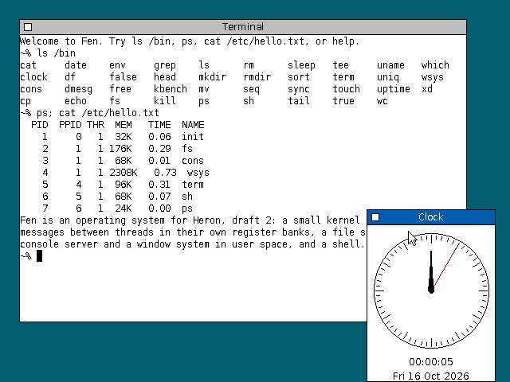

# Report 0036: Fen: an operating system on draft 2

Fen ([studies/fen](../studies/fen/README.md)) is a first operating system
for draft 2 in system mode, as [RFC 0029](0029-rfc-draft-2-system.md)
specifies it, written to get something working and to battle-test the
system half of the instruction set. It is the step RFC 0029's next steps
ask for: the system half in the simulator, then a kernel on it, measured
with full banks and the window. It is a study, and much of it will
change.

What there is: a message-passing kernel (72 KB, 2,700 lines of C and
assembly) in which every thread has a register bank and every process a
context of the page map; servers in user space for the file system, the
serial console and the window system, each driving its own device; a C
library with `spawn` in place of `fork`; a Bourne-flavoured shell and
thirty-odd utilities; and a desktop with movable, resizable windows, a
terminal and a clock. Programs are compiled by the repository's C
compiler for draft 2 ([report 0030](0030-report-c-compiler-draft-2.md)).
It runs on the instruction-level simulator, on a board the study defines
(`studies/fen/board`), and boots to a shell on the serial console in
0.4 s of simulated time, or to the desktop in 1.0 s.

Cycles are the simulator's reference timing, D16-overlap (a 16-bit
datapath), at 6 MHz, unless a figure says D32-separate, the configuration
of the built 1b hardware that [report 0020](0020-report-operating-system.md)
measured its nucleus in. The tables are generated:
[performance.md](0036-report-fen/performance.md) by
`heron fen bench --write`, with the picture above.

## Summary

1. **The system half works as specified.** Fen uses every part of
   RFC 0029 (supervisor and user mode, the window, the translated space
   with its 128 contexts, precise page faults, 256 register banks with
   `MFUR` and `MTUR`, a vector for each `SWI`, eight interrupt levels,
   `HALT` waiting for an interrupt) and needed nothing it doesn't have
   but the bank-to-bank copy of open question 3. Where the RFC leaves a
   choice open, the simulator takes the RFC's proposal or makes one
   ([2.1](#21-what-the-simulator-chose)), and none of them got in Fen's
   way.
2. **Banks make a switch nothing to speak of.** A thread's registers stay
   in its bank, so a switch rewrites the two words of the trap frame and
   sets `bank` and `ctx`: 124 cycles, in compiled C. A null system call
   is 64 cycles, of which the dispatch is one `JMP` in the `SWI`'s own
   vector.
3. **`BCOPY` earns its place:** with it a message is one instruction, and
   a call and reply between processes takes 128 cycles (8.5%) fewer than
   moving the eight words through the kernel's registers with `MFUR` and
   `MTUR`. Fen proposes it for open question 3 as built: `BCOPY rd, rs`,
   cell `F9`, the banks' numbers in registers, a microcoded loop.
4. **The window's reach costs little.** The kernel runs at
   `0x8000_0000`, out of reach of the 16- and 24-bit absolute modes, so
   the compiler gives it all its data 32-bit addresses and its tables
   PC-relative ([2.3](#23-the-window-and-the-short-addresses)). That is a
   third parcel on 7% of the instructions the kernel executes, and
   under 2% of its cycles: not worth an ISA change.
5. **The board needs two things RFC 0029 doesn't have:** an interrupt
   mask, since the lines are level-sensitive and a kernel that hands an
   interrupt to a user-level driver has to hold it off until the driver
   has run; and each device on a page of its own, so that the page map
   can give each to its driver. They are about two chips and a choice of
   address lines. With the timer, they are Fen's answer to open
   question 2, the physical memory map ([1.2](#12-the-board)).
6. **Compiled C is where the time goes, not the hardware.** A call and
   reply between processes is 1,383 cycles (1,478 on D32-separate),
   against 347 for report 0020's hand-written nucleus: Fen's kernel
   executes about 350 instructions a round trip where the nucleus
   executed 63, in small C functions that keep their globals in memory. A direct
   switch from client to server and back, past the run queue, took it
   from 2,169. A fast path in assembly is where to look next.
7. **A 16-bit datapath makes pixels dear.** Moving a 562 × 381 window
   is 114 ms, and scrolling a terminal costs as much as copying the
   window. The window system needed the graphics library's fills and
   blits in draft 2's assembly, eight registers at a time with `LDM` and
   `STM` (6 cycles a word copied, against about 75 for the C), and
   windows kept on word boundaries, since a copy that has to shift costs
   four times one that doesn't. The terminal draws what changed at most every 80 ms
   while output streams: `seq 200` takes 0.8 s in a window, 0.2 s on the
   serial console.

## 1. What Fen is

### 1.1 The tools

- **The assembler and disassembler** know the system half: the special
  registers by name (`sr`, `far`, `fsr`, `ctx`, `mapa`, `mapd`, `bank`,
  `bkpt`), `MFUR`, `MTUR`, `SWI`, `SPL`, `EI`, `DI`, `RTI`, `HALT` and
  `BCOPY`, and link up to the top of the address space.
- **The simulator** has system mode beside the machine the programs have
  always run on, which stays as it was: `Machine::new` is that machine,
  `Machine::new_system` the one with a supervisor, a page map, banks,
  exceptions and interrupts, and a `Bus` that the board answers beyond
  RAM (`studies/v2_isa/isa/src/sys.rs`). It caches the PC's page and
  decodes by physical address, and skips the time a `HALT` waits, so an
  idle desktop costs the host almost nothing: booting the desktop and
  running for ten simulated seconds takes under a second.
- **The C compiler** has a window mode for the kernel: every global far,
  and indexed tables addressed `[pc + table + x*s]` (mode E of the special
  modes) instead of `[table + x*s]`. Nothing else in it changed.

### 1.2 The board

The study's board is a CPU board with RAM, a timer and an interrupt mask,
a video card, and an I/O card, on the system bus's slots
([RFC 0014](0014-rfc-system-bus.md)). The physical memory map:

| Physical | What |
|---|---|
| `0x0000_0000` | slot 0, the CPU board: RAM (4 MB) |
| `0x0F00_0000` | the timer: a free-running microsecond counter and a compare register that interrupts at level 6 |
| `0x0F00_1000` | the board's information: RAM size, clock, boot flags (and the simulator's debug port) |
| `0x0F00_2000` | the interrupt mask: the levels requesting, and a mask, a bit per level |
| `0x1000_0000` | slot 1, the video card: 2 MB of VRAM, 640 × 480 at 8 bits (a 1,024-byte stride), registers at `0x1FF0_0000` |
| `0x2000_0000` | slot 2, the I/O card, a 4 KB page per device: a 16C550 UART, a CompactFlash card in True IDE mode, two PS/2 ports, a clock |
| anything else | nothing answers: a bus error |

- **The interrupt mask.** RFC 0029's lines are level-sensitive: a request
  stays up until its handler clears the cause. When the handler is a
  driver in user space, the kernel can't clear it; it notifies the
  driver, and without a mask it would take the same interrupt again the
  moment it returned. Fen's kernel masks the level when it notifies the
  driver and unmasks it when the driver calls `irq_ack`. The mask is an
  8-bit register and eight AND gates (the 8259's IMR).
- **A page per device.** The I/O card decodes A12–A13 to choose its
  device, so each device is a page of its own and the page map gives the
  file server the CF card, the console the UART and the window system
  the PS/2 ports, and each nothing else.
- **The timer** is a free-running count of microseconds and a compare
  register. The kernel sets the next tick in it each time (100 a second),
  and counts the ticks it missed while it had interrupts off, from the
  counter. Levels: 6 the timer, 5 the UART, 4 the CF card, 3 the PS/2
  ports, 2 the video card's vertical blank (unused).

### 1.3 The kernel

The kernel (`studies/fen/kernel`) is the message-passing nucleus of
report 0020 grown into a system: threads, address spaces, ports and
messages, interrupts as notifications, and little else.

- **Threads and processes.** A thread is a register bank (1–255; bank 0
  is the kernel's) and a process a context (1–127). The scheduler runs
  the highest of 32 priorities, found with `CLZ` in a bitmap, round robin
  within a level with a 50 ms slice; a thread that wakes runs before the
  others of its level. The kernel runs with interrupts off throughout, on
  one stack, and the trap frame of whoever entered from user mode is
  always at the top of it, so switching is rewriting that frame and
  setting `bank` and `ctx`. With nothing to run it waits in `EI; HALT`,
  which RFC 0029 makes safe: no interrupt is taken straight after `EI`.
- **Messages.** A port belongs to a process. `ipc_call` sends eight words
  in `r0`–`r7` and waits for the reply in the same registers; a server's
  `ipc_recv` gets them with a `rcvid` in `r8` and the sender's process in
  `r9`, and answers whenever it likes with `ipc_reply` (a reply can be
  deferred: the console answers a read when a line is typed). `BCOPY`
  moves the message from bank to bank. A `rcvid` carries the waiting
  thread's bank and a generation, so a reply can't reach a thread that
  has since taken the bank. While a client waits, its server may read and
  write its memory (`ipc_read`, `ipc_write`, one copy through the window)
  or map its pages (`ipc_map`). When the server a call wakes would be
  chosen to run anyway, the kernel switches to it directly, past the run
  queue, and the reply does the same back.
- **Notifications** are bits on a port, delivered to a receiver as a
  message with `rcvid` 0. Interrupts, a process ending (with a log of
  which), and alarms (`alarm(port, bits, µs)`) arrive as notifications,
  so a server waits for all of them and for its requests in one place.
- **Memory.** Pages are reference-counted, and the page map is the only
  page table: the kernel reads a process's entries back through `mapa`
  and `mapd`. A process's text is mapped read and execute, the rest read
  and write (W^X), the stack grows on demand, a page at a time, down to
  1 MB, including when the kernel itself faults copying into it. A
  driver maps its device's physical pages (`vm_map_phys`, for processes
  started with the I/O privilege), and processes can share pages.
- **Processes** are made empty (`proc_create`), filled by their parent
  (`vm_alloc`, `vm_write`) and started (`thread_create`); the C library's
  `spawn` does that for an executable, with the arguments, environment,
  descriptors and directory in a block on the new stack. There is no
  `fork`. A process that faults ends with status 128 + a signal number,
  as a shell expects.
- **43 system calls**, from one table (`syscalls.py`) that generates the
  `SWI` vectors, the kernel's stubs and the C library's. Each `SWI #n`
  has its vector, which jumps to its stub.
- **Boot.** The boot image is the kernel and an archive of the programs
  needed before there is a file system (init, the file server, the
  console); the kernel starts init, which starts the others from it.

### 1.4 User space

- **The file protocol** (`include/fen/fs.h`) is what every server of
  files speaks: open, read, write, seek, stat, readdir and so on, and
  `FS_DUPTO`, which gives another process a descriptor for the same open
  file (how `spawn` passes descriptors on). The C library finds a server
  by a small mount table (`/dev/cons`, `/`) and keeps a descriptor as a
  port and the server's handle.
- **The file server** (`srv/fs`) drives the CF card by its interrupt,
  keeps a 96-block cache (write-through), and holds Fen's file system,
  fenfs: 1 KB blocks, a bitmap, 64-byte inodes with 11 direct blocks and
  an indirect and a double indirect one, and `/dev/null`, `/dev/zero` and
  `/dev/klog` as devices. Pipes are the file server's too. `mkfs.py`
  writes and reads the image on the host.
- **The console server** (`srv/cons`) drives the UART by its interrupts,
  with the line discipline (echo, erase, kill, ^D, ^C to the foreground
  process group).
- **The shell** (`cmd/sh.c`) has pipelines, redirections, `;`, `&&`,
  `||`, `&`, quoting, variables and `$?`, globbing, jobs, `cd`, `export`
  and `source`. The utilities: `cat cp date df dmesg echo env false free
  grep head kill ls mkdir mv ps rm rmdir seq sleep sort sync tail tee
  touch true uname uniq uptime wc which xd`.

### 1.5 The desktop

- **The window system** (`srv/wsys`) owns the video card, the keyboard
  and the mouse. It is the Egret desktop's window manager
  ([report 0021](0021-report-egret-gui.md)) on the graphics study's
  library ([report 0019](0019-report-graphics.md)), at 8 bits per pixel.
  A program sends batches of drawing commands (fills, frames, lines,
  text, ellipses, polygons, pixels, scrolls), which are drawn through the
  visible parts of its window; wsys keeps nothing of a window's content,
  and whatever comes into view is an expose event the program answers by
  drawing again. Windows move by their title bars, grow by a corner and
  close by a box; a click on the desktop opens a menu of programs
  (`/etc/menu`). The cursor is drawn in software.
- **The terminal** (`cmd/term.c`) is a window and the file server of its
  shell's descriptors 0, 1 and 2, and so of everything the shell starts:
  the console's line discipline in front, enough ANSI escapes behind for
  a full-screen program, and the cells drawn in runs of one colour.
- **The clock** waits on one port for its window's events and for an
  alarm a second.
- **libgui** (`lib/gui.c`) wraps the protocol for programs.

## 2. The system half under an operating system

### 2.1 What the simulator chose

Where RFC 0029 leaves something open, the simulator takes this:

- `MTSR sr` changes every bit but S (open question 9's proposal). Fen
  only ever leaves supervisor mode with `RTI`, and never missed the bit.
- An access to a physical address that nothing answers is a bus error,
  through the reserved vector `0x8000_000C`, with `far` set (open
  question 2). Fen's kernel ends a user process that causes one, as it
  does for any fault it can't mend.
- A fault while an exception is being entered stops the simulation. Fen
  keeps bank 0's stack in the window, where pushes can't fault, as the
  RFC advises, and it never happened.
- There is no non-maskable interrupt, and the breakpoint register holds
  what is written to it and does nothing.
- `BCOPY rd, rs` copies `r0`–`r7` of bank `rs` into bank `rd`, both
  numbers in registers, in cell `F9`, timed as a microcoded loop: per
  register a read from one bank, a write to the other and the loop's
  step.

### 2.2 What each part did

- **Supervisor and user mode, `sr`.** Everything user code can't do
  traps as a privilege violation, which Fen turns into the process
  ending.
- **The translated space** is what makes copying cheap: in supervisor
  mode the low 16 MB are the current process's, so a system call uses
  the caller's pointers as they are, and a copy that faults is a page
  fault in the kernel at a known address, which resumes at the copy's
  error exit (or, for the user's stack, maps the page and carries on).
  Copies between two other processes go through the window: one side by
  its physical page, the other as it is.
- **128 contexts** are more than Fen has used (it boots the desktop with
  six processes, and a shell pipeline adds a few). Switching context is
  one `MTSR`, and nothing is flushed. Clearing a context's 4,096 entries
  through `mapd` is about 23,000 cycles, so the kernel clears a context
  once, the first time it is used (the map is undefined after reset),
  and when a process ends it clears only the entries between the lowest
  and the highest it used in each of its three regions (image and heap,
  mappings, stack).
- **Precise faults** do what they promise: a stack page faults in on
  demand and the instruction is restarted, `far` and `fsr` say what
  happened, and a store to text or a jump into data is caught by W and X.
- **The register banks** decide Fen's whole shape: a thread is a bank,
  messages are registers, a system call saves nothing, and a switch is
  two special registers and a frame. 255 threads is the limit for the
  whole system, which was never close. `MFUR` and `MTUR` take the
  register number in the instruction, so the kernel's "register n of
  bank b" is a jump into a table of them, about 25 cycles where an
  `MFUR` naming the register is one instruction. The IPC calls read the
  port and the `rcvid` that way, three times a round trip; writing them
  in assembly would name the registers.
- **`SWI` with a vector each** makes the dispatch a `JMP`: report 0020
  had it as 16 of a null call's 39 cycles, and asked for exactly this.
- **Interrupts.** Fen uses three levels for devices and one for the
  timer. The kernel never enables interrupts inside itself, so it never
  uses `SPL`. User-level drivers work, with the mask
  ([1.2](#12-the-board)): an interrupt becomes a notification to the
  driver's port. (A notification and its receipt, in one thread, is 558
  cycles.)
- **`HALT`** waits for an interrupt with I set, so the idle loop is
  `EI; HALT; DI`, and since nothing is taken straight after `EI`, an
  interrupt between the check for work and the `HALT` can't be lost.

### 2.3 The window and the short addresses

The kernel lives in the window, at `0x8000_0000` and up. Draft 2's
absolute modes are 16 bits, sign-extended (`0`–`0x7FFF` and the top
32 KB), and 24 bits in the special mode D, sign-extended (the low and
high 8 MB); neither reaches the window. So the compiler's window mode
gives the kernel's globals 32-bit addresses, a third parcel on every
access, and addresses its jump and switch tables relative to the PC.

Measured over the IPC benchmark, 7% of the instructions the kernel
executes carry a 32-bit address, and the extra parcel costs a cycle
each: 1.7% of the kernel's cycles. That is small next to what the code itself costs
([3](#3-what-it-costs)), and the compiler's mode is an adequate answer.
If it ever mattered, the window could sit at the top of the address
space instead (physical `x` at `0xFF80_0000 + x` for the first 8 MB),
where mode D's sign-extended 24-bit addresses reach it.

User programs see the other side of the same choice: 16-bit addresses
reach `0`–`0x7FFF`, so a program's near data (linked from `0x1000`,
above a page left unmapped to catch null pointers) has 28 KB, and the
rest of its data is far. The window system, the biggest program, has
12 KB of near data.

### 2.4 `BCOPY`

A message is eight words in `r0`–`r7`, and with a bank per thread it has
to get from the client's bank to the server's. `BCOPY` does that in one
instruction; without it the kernel sets `bank`, reads the eight words
into its own registers with `MFUR`, sets `bank` again and writes them
with `MTUR` (`bank_copy_ur` in `entry.s`). Measured with the kernel built
each way (`COPY_UR`):

| | cycles | without `BCOPY` |
|---|---:|---:|
| a call and reply to another process | 1,383 | 1,511 |
| a call and reply to a thread of the same process | 1,361 | 1,489 |
| `spawn` and `waitpid` of `/bin/true` | 124,293 | 125,418 |

That is 64 cycles a message, two messages a round trip. Even as a slow
microcoded loop it is worth its cell, and it is what makes passing
messages in registers the natural design rather than one to argue for.
The kernel also writes the receiver's `r8` and `r9` (the `rcvid` and the
sender) with two `MTUR`s after it; a `BCOPY` of ten registers wouldn't
pay for the change.

## 3. What it costs

From [performance.md](0036-report-fen/performance.md):

| | cycles | at 6 MHz |
|---|---:|---:|
| a null system call | 64 | 11 µs |
| `notify` a port, and `ipc_recv` the notification | 558 | 93 µs |
| a call and reply between processes | 1,383 | 231 µs |
| `vm_alloc` and `vm_free` a page (zeroed) | 5,152 | 0.9 ms |
| `spawn` and `waitpid` a program | 124,293 | 21 ms |
| boot to the desktop's prompt | 5.6 M | 1.02 s |
| move a 562 × 381 window | 684,000 | 114 ms |

Data moves at 1,437 KB/s reading a cached file, 885 KB/s through a
pipe, and 135 KB/s writing a file through to the card (every block and
every change to an inode or the bitmap is written at once).

**Where a call and reply goes.** About 350 instructions in the kernel
and 1,100 cycles of the 1,383; the rest is the two user-side stubs
(each moves the message between memory and `r0`–`r7` with `LDM` and
`STM`) and the loop. The kernel's part is two traps, two direct
switches (124 cycles each), looking up the port and checking it
(35 cycles each time), delivering the message, checking the `rcvid` on
the reply, and the bookkeeping of the thread states, each a small C
function whose globals are in memory. Report 0020's nucleus did a call
and reply in 347 cycles on D32-separate, where Fen takes 1,478: it was
63 instructions of hand-written assembly with less to check. Before the
direct switch, the call put the server on the run queue and the
scheduler took it off again, and a round trip was 2,169 cycles.

**The desktop.** Drawing is most of what the window system costs. On a
16-bit datapath, copying a word of pixels costs 6 cycles at best: an
`LDM` and an `STM` of eight registers are 19 cycles each, and the loop
adds 10 for every eight words. A window move is one copy of the window
(52 ms of the 114) and painting the desktop it uncovers. The same move
took 700 ms with the graphics library's C kernels, 300 ms with fills and
blits in draft 2's assembly four registers at a time, 136 ms once
windows were kept on word boundaries so that the copy needs no shift
(a shifted word is 27 cycles), and 114 ms with eight registers at a
time.

A terminal scrolling copies its whole window, about 300,000 cycles, so
the terminal scrolls once for however many lines came since it last
drew, drawing at most every 80 ms while output streams and at once when
a program reads or a key is typed; it fills blank cells instead of
drawing spaces, and wsys fills the strip a scroll opens instead of
asking the terminal to draw it. Before those, `seq 200` took 14.3 s in a
terminal; now 0.8 s.

## 4. What Fen doesn't do yet

- **Users and permissions:** there are none; fenfs keeps modes and
  nothing checks them. Process groups and `kill` are the only control.
- **The Plan 9 side** (per-process name spaces, everything a file
  server) is half there: every server speaks one file protocol, but the
  mount table is the C library's and fixed.
- **No networking**, no `select` (servers wait on notifications, clients
  block), no memory-mapped files, no swapping, no signals beyond ending a
  process with a status.
- **The file system** writes through, and has no journal or check.
- **The desktop** has two bitmap fonts, one depth and one screen size, no
  clipboard and no editor. A full-screen editor in the terminal is the
  most useful thing missing.
- **Performance:** the IPC fast path in assembly (call, receive, reply
  and the direct switch), text drawing in assembly (the glyph expansion
  is still the graphics library's C), and a write-back cache.
- **Not tried:** a real boot from ROM (the host loads the boot image into
  RAM), the non-maskable interrupt, the trace exception beyond the
  simulator's tests, and more than one CPU.

## 5. For the RFCs

Nothing here decides anything; these are what Fen suggests:

1. **RFC 0029, open question 3:** `BCOPY rd, rs` as built (cell `F9`,
   bank numbers in registers, a microcoded loop), which saves 8.5% of a
   round trip.
2. **RFC 0029, open question 2:** the board's memory map in
   [1.2](#12-the-board) as one answer, with the interrupt mask, a page per
   device on the I/O card, and a bus error through `0x8000_000C`.
3. **RFC 0029, the window:** nothing needed; the cost of its reach is
   under 2% of the kernel's cycles. A window at the top of the address
   space would remove it if that ever matters.
4. **RFC 0029, open question 9:** `MTSR sr` leaving S alone worked.
5. **The timer** (a microsecond counter with a compare register) and the
   video card (a framebuffer with a palette) are the study's own, and an
   RFC for the CPU board's devices would settle them.
