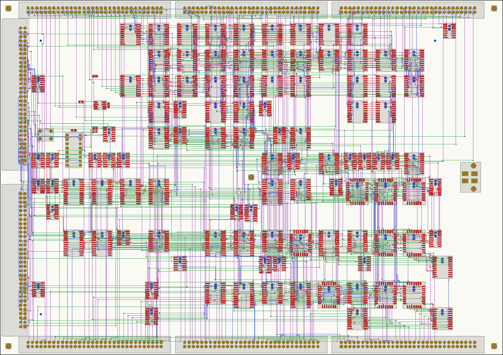
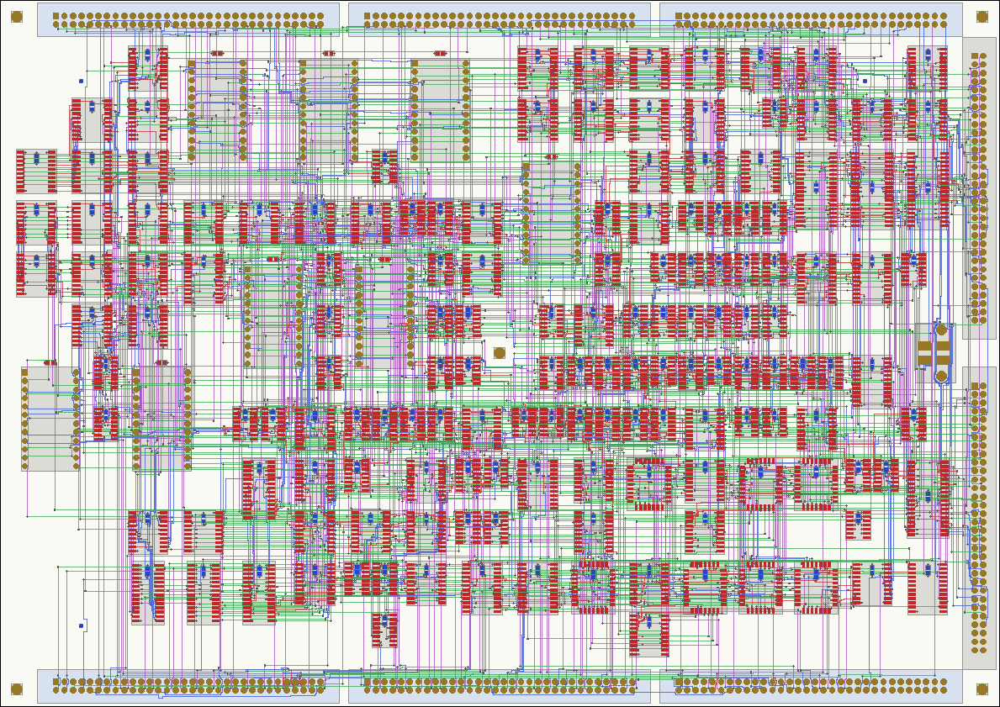
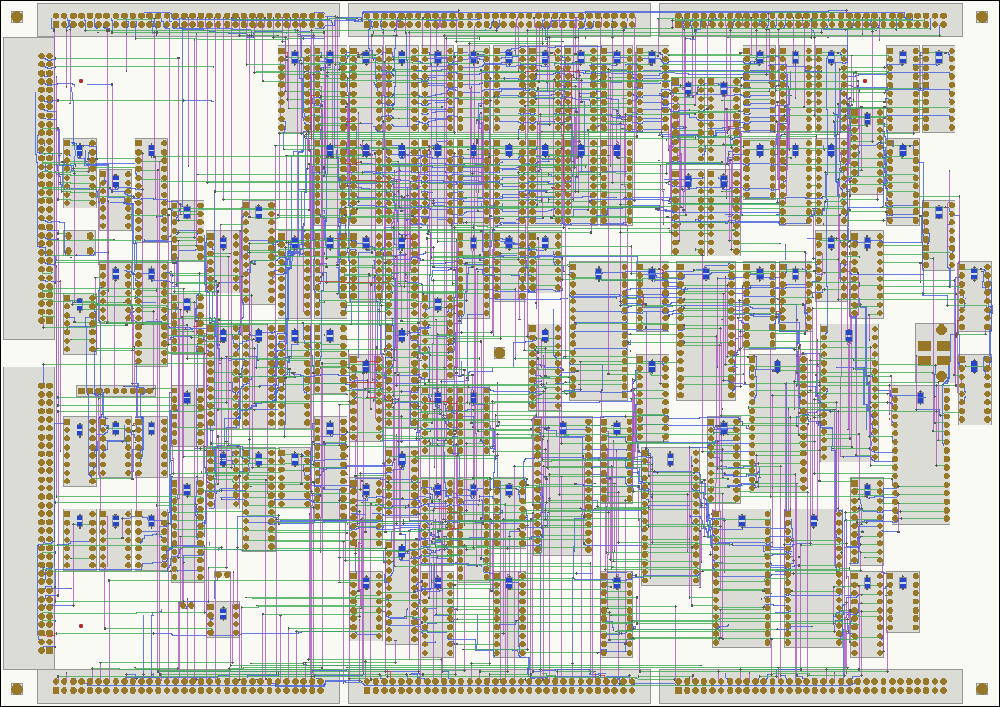

# Report 0044: Heron Mini's CPU boards: a first cut

Heron Mini ([RFC 0041](0041-rfc-heron-mini.md)) is cut into three A4
boards stacked on standoffs and joined by IDC ribbon cables
([RFC 0041, 28](0041-rfc-heron-mini.md#28-the-boards)): bottom to top,
cpu1 (the sequencer's side), cpu2 (the datapath and the memory) and io
(the video and the devices, to be designed later). This report is the
first cut of the two CPU boards through RFC 0023's flow
([RFC 0023](0023-rfc-pcb-flow.md)): both placed, routed and checked,
the stack's mechanics modelled, every net's delay measured across both
boards and the cables between them, and those delays put back into the
mini's timing analysis. It is not a final design. It is meant to give
the timing analysis real numbers in place of RFC 0041's flat 1.5 ns a
crossing, and to find early what the boards ask of the design: whether
the parts fit, how many layers, what the cables take, which nets are
long.

The netlist is RFC 0041's at commit 1a4346d (the study `mini`); the
code is [studies/pcb](../studies/pcb/README.md)'s `mini.py` and the
flow's own files; the generated tables are in
[results.md](0044-report-mini-cpu-boards/results.md), every net's
delays in [delays.json](0044-report-mini-cpu-boards/delays.json).

## Summary

- **Both CPU boards fit A4 and route on six layers as surface-mount
  boards,** and pass every check the flow has (the netlist, the copper's
  connectivity, KiCad's DRC, the fab's test netlist, the keep-outs):
  cpu1, 109 chips, in 53.2 m of track; cpu2, 160 chips, in 91.9 m.
  SOIC logic, the control store in PLCC-32, the SRAMs in SOJ as RFC 0041
  has them, the 74F181s in DIP ([3](#3-density-smd-or-dip-four-layers-or-six), [4](#4-the-boards)).
- **In DIP, cpu2 doesn't fit A4** at any spacing tried: 1.5 times the
  slots at RFC 0026's spacing, 1.2 times soldered by hand with 1 mm
  between pads, and still too many with the courtyards touching. cpu1
  fits by hand and routes, on six layers and on four. So the CPU's two
  boards can't both be DIP on A4; one can.
- **Layers:** cpu1 routes on four layers in SMD and in DIP; cpu2
  needs six: on four, 25 of its nets are still in conflict after the
  router's 60 rounds.
- **The stack:** neighbours on facing vertical headers, the lower
  board's top side to the upper board's bottom, pin k over pin k, a
  55 mm ribbon (0.30 ns); cpu1's cables to io loop past cpu2 from
  right-angle headers at an edge (120 mm, 0.62 ns). cpu1-cpu2's six
  64-way cables take both long edges ([1](#1-the-stack)).
- **The delays** of every net, driver to load across both boards and the
  cables, are in [delays.json](0044-report-mini-cpu-boards/delays.json),
  and `heron mini hw sta --pcb` takes them. A crossing costs about 2 ns
  of flight (0.3 of it the cable), not 1.5; a driver's latest load on
  its own board is 0.6 ns away typically, 3.5 at most. The heavy nets'
  loads cost more than their flights: 5 to 9 ns on RESET_n, FILL, DECGO,
  the B bus and the data bus ([5](#5-the-delays)).
- **The timing:** on the first cut the suite and the C programs take 5%
  (the flights alone) to 8% (with the loads as the datasheets derate
  them) longer than on one board, against 0% with RFC 0041's flat
  1.5 ns. Placed for wire length alone it was 5 to 17%: one round of
  placing the nets on the slowed critical paths closer halved what the
  loads cost ([6](#6-the-timing)).
- **At chip level** the suite runs with the routed delays as on the RTL
  model, with no timing violation (at length classes two ticks longer).
  Getting there found a race in the write window (MWIN against T2, a
  registered MWIN would remove it), and the boards lengthen the B bus's
  worst hand-over overlap from 6.4 to 9.4 ns ([6](#6-the-timing)).
- **The clocks need a buffer tree on each board,** in the netlist: CLK is
  one 22V10 output reaching 60 inputs over 1.7 m of copper as routed.
  Also found: the AS7C4096A's pinout (36 pins, not 32), the clock chip's
  3.3 V, a lopsided cut (cpu1 60% full, cpu2 90%), the microcode's
  flashes now on the bottom two boards ([2](#2-parts-and-packages),
  [7](#7-what-else-the-first-cut-found)).

## Contents

1. [The stack](#1-the-stack)
2. [Parts and packages](#2-parts-and-packages)
3. [Density: SMD or DIP, four layers or six](#3-density-smd-or-dip-four-layers-or-six)
4. [The boards](#4-the-boards)
5. [The delays](#5-the-delays)
6. [The timing](#6-the-timing)
7. [What else the first cut found](#7-what-else-the-first-cut-found)
8. [The flow](#8-the-flow)
9. [For RFC 0041, and what's next](#9-for-rfc-0041-and-whats-next)

## 1. The stack

<!-- blocks
box io "io (later)" "video, bank 1, I/O devices" at 20,0 width=40
box cpu2 "cpu2: 160 chips" "datapath, register file, memory" below io gap 8 width=40
box cpu1 "cpu1: 109 chips" "sequencer, clock, control store" below cpu2 gap 8 width=40
cpu1.top-8 <-> cpu2.bottom-8 "6 cables, N and S"
cpu2.top+13 <-> io.bottom+13 "2 cables, E"
cpu1.left <-> io.left via 3,28.5 3,2.5 "2 cables, W"
-->

Bottom to top cpu1, cpu2, io, as Emily asked; cpu2 in the middle, as
the board cut already had it ([RFC 0041, 28](0041-rfc-heron-mini.md#28-the-boards)),
so the cut and its cables don't change. How the boards are joined is
open; the first cut models it with 0.1 inch headers and IDC ribbon, as
RFC 0041 has it, and puts each cable where it runs straight from one
board to the other without a twist (`mini.SITES`, `heron pcb mini
sites` checks it):

- **Neighbours face each other.** A vertical shrouded header on the
  lower board's top side and one on the upper board's bottom side,
  right above it, pin k over pin k; the ribbon makes a U between them.
  cpu1-cpu2's six 64-way cables are along the long edges, three on the
  north and three on the south; cpu2-io's two along the east edge (io's
  are then on its bottom side).
- **cpu1-io skips cpu2:** right-angle headers at cpu1's west edge, the
  ribbon looping up past cpu2's west edge to the same headers at io's.
- **The spacing:** 35 mm board to board: two mated headers face to
  face, about 13 mm each, and room for the ribbon's U.
- **The cables' lengths and delays:** 55 mm between neighbours (the
  spacing and 20 mm for the U), 120 mm for the loop (twice the spacing
  and 50 mm out of the headers and round). A 1.27 mm ribbon of 28 AWG
  with a ground beside each signal is about 100 ohms and 47.5 pF/m
  (3M's 3365), so about 4.9 ps/mm: 0.30 ns between neighbours and
  0.62 ns for the loop, with 15 ps a header.
- **Holes:** M3 standoffs at the corners, 5 mm in, and one in the
  middle, which an A4 board pushed by 64-pin sockets wants; RFC 0026's
  R14 keep-outs around each (ø8 mm), the planes kept out too, so a
  metal standoff touches no copper.
- **Power:** a 2 × 2 Mini-Fit Jr on each board (two pins of 5 V, two of
  ground, 9 A a pin), just inside the east edge. The ribbons' grounds
  join the boards' planes as well, 201 wires of them between cpu1 and
  cpu2.
- **Fiducials:** three on each side (R21): both sides have parts, the
  capacitors under the chips on the bottom.

**Room at the edges.** The six 64-way headers between cpu1 and cpu2
take the long edges whole (3 × 90 mm of 297), and the io cables two
of the short edges. cpu1 has its east edge left, cpu2 its west edge
(past which cpu1's cables to io run). Right-angle headers for every
cable, all at the edges, would need ten 90 mm sites around each board
(its eight and the two that pass it), about all its perimeter has
between the corner holes: that is why neighbours face each other
instead. Smaller headers don't help (a header takes about the same
edge a signal whatever its size); a ground every two signals
(`--per-ground 2`) would make five cpu1-cpu2 cables of six.

## 2. Parts and packages

RFC 0041's parts are DIP but for the SRAMs. The first cut is a
surface-mount board, the style the flow calls `smd` (section 3 says
why):

| Part | Package |
|---|---|
| 74F, 74ABT, 74ACT logic | SOIC (narrow for 14 and 16 pins, wide for 20 and 24) |
| ATF22V10C-5 | SOIC-24 wide |
| SST39SF010A, the control store | PLCC-32 |
| AS7C256A-12, the register file | SOJ-28 (300 mil), as RFC 0041 has it |
| AS7C4096A-12, bank 0 | SOJ-36 (400 mil), as RFC 0041 has it |
| 74F181 | DIP-24 (0.6 inch): the flow keeps it in DIP, as RFC 0023 did for the 74LS181 |
| CY22393, the clock chip | a DIP-16 adapter (RFC 0041, 20), below |
| TL7705A | SOIC-8 |
| decoupling | 100 nF 0603 under each chip, on the bottom (R18) |

Two pinouts were missing or wrong, and are now in `infra/pcb/packages.py`:

- **The AS7C4096A-12 has 36 pins,** in a 400 mil SOJ with the supplies
  in the middle (or a 44-pin TSOP); there is no 32-pin version. The
  netlist's `sram512` type had the 32-pin JEDEC pinout of the AS6C4008,
  which the full Heron's memory card uses. A part number can now have
  its own pinout (`packages.PART_PINOUTS`): the AS7C4096A's is the
  JEDEC 36-pin SOJ, checked against KiCad's IS61C5128AL symbol, the same
  pins. And the fast SRAMs are SOJ in every board style
  (`PART_PACKAGES`): no fast SRAM is made in DIP.
- **The CY22393 is a 3.3 V part** (Infineon's datasheet, 001-95834):
  RFC 0041, 20 puts it in TSSOP on a small adapter. The board takes a
  DIP-16 adapter with the chip's own pin numbers, except that pin 2 is
  the adapter's 5 V in, from which it makes the chip's 3.3 V (VDD and
  AVDD); the crystal, OE tied high and the unused outputs stay on the
  adapter. Its serial pins are pulled up to 5 V on the board (RN_POR),
  over the chip's limit: the adapter would need level shifting there
  (or the pull-ups go on the adapter, to 3.3 V). Since 1a4346d the
  mini's netlist has done it properly (bc6ed8b, on RFC 0041's branch):
  the chip in TSSOP with its own regulator, crystal and pull-ups to
  3.3 V, so the next cut takes those parts on cpu1 in place of the
  adapter.

## 3. Density: SMD or DIP, four layers or six

RFC 0041 wants DIP parts, for soldering by hand, and A4 boards of at
most 190 chips, 160 or fewer if the boards allow it. With RFC 0026's
spacing they don't: a grid of DIP slots on A4, inside the headers, has
too few slots for either CPU board (results.md, *What fits on A4*,
where the numbers below come from; `heron pcb mini fit`):

| Packing | cpu1 (109 chips) | cpu2 (160 chips) |
|---|---|---|
| SMD, RFC 0026's spacing | 59% of the slots: fits | 89%: fits |
| DIP, RFC 0026's spacing (2.54 mm between through-hole pads) | 101%: 20 chips without a place | 149%: 90 without a place |
| DIP soldered by hand: 1 mm between pads, the capacitors under the chips | 79%: fits | 120%: 53 without a place |
| DIP with the courtyards touching (0.5 mm between pads) | 68%: fits | 99%: 31 without a place |

(The share is the slots the parts' blocks need over the slots the
headers, holes and fiducials leave; past about 90% the blocks don't all
find a place.)

- **RFC 0026's spacing is for an assembly house's selective soldering:**
  2.54 mm between through-hole pads, 5 mm around them on the bottom.
  A board soldered by hand needs less, as many TTL boards of the 1970s
  had (DIPs in columns 0.4 inch apart leave about 1 mm between pads). The
  `--tight` packing has 1 mm between through-hole pads, 1.5 mm to a
  surface-mount one, and each chip's 100 nF as an 0805 under it, between
  its pin rows, on the bottom: soldered by hand after the chips, against
  R17 (nothing under a through-hole part), which is about wave and
  selective soldering.
- **cpu2 doesn't fit A4 in DIP** at any spacing tried, not even with the
  courtyards touching, which leaves no room to route. Its 31 74F153s,
  31 74ABT541s and 22 74F161s are most of it; its eight 74F181s and
  seven control store flashes are the biggest parts.
- **cpu1 fits A4 in DIP soldered by hand, and routes,** on six layers and
  on four (section 4). So DIP is possible for one of the two boards.
- **In SMD both fit, with room** on cpu1 (about 60% of its slots) and
  little on cpu2 (about 90%): the cut could move chips from cpu2 to cpu1
  (section 7). The eight 74F181s are a fifth of cpu2's slots: a DIP-24
  among SOICs keeps 2.5 mm to them (R16), so each takes 3 × 3 slots.
  In SOIC-24 (the 74F181SC, if it can be found) they would take a
  quarter as much.

**Layers:** both boards route on six (signal, ground, signal, signal,
power, signal: R2), with no conflict, in 11 and 39 of the router's rounds. cpu1
routes on four as well, in SMD and in DIP; cpu2, at 90% of its slots,
doesn't: after the router's 60 rounds 25 nets are still in conflict, on
100 m of track and 6,442 vias (92 m and 4,295 on six). Moving twenty or
so chips to cpu1 (section 7) might let it. RFC 0023's CPU card didn't route as a grid on four layers at
any size; cpu1 does because it is sparse.

## 4. The boards

*cpu1 (bottom of the stack), the first cut: its chips on a grid of
slots, the six headers to cpu2 along the long edges, the two right-angle
headers to io at the west edge (left), the power connector at the east,
the standoffs' holes at the corners and in the middle. Red: the top's
pads and tracks; green and purple: the inner signal layers; blue: the
bottom, with the decoupling capacitors under the chips.*

*cpu2 (in the middle): its headers to cpu1 on the bottom side, under the
long edges, and to io on the top at the east edge. The eight large
blocks with round pads, mostly in the left half, are the 74F181s in
DIP; the square ones at the bottom right, the control store's
flashes in PLCC.*

Both boards are placed on RFC 0026's grid (R15: every chip the same way
round, in rows and columns of slots), routed by the flow's own router on
the four signal layers of a six-layer stack, and pass every check the
flow has (results.md, *The boards built*):

| | cpu1 | cpu2 |
|---|---:|---:|
| chips | 109 | 160 |
| parts, with capacitors, headers, holes, fiducials | 238 | 340 |
| signal track | 53.2 m | 91.9 m |
| vias | 2,430 | 4,295 |
| differences from the netlist, copper opens and shorts, KiCad DRC errors, fab test netlist differences | 0 | 0 |

(cpu1's 109 chips are RFC 0041's 107 packages, a resistor network and
the debug button, which the cut doesn't count.)

The other variants are in results.md: the same boards placed for wire
length alone (section 6), on four layers (section 3), and cpu1 as a DIP
board soldered by hand, which routes on six and on four layers:

*cpu1 in DIP, 1 mm between pads, the capacitors under the chips; the
rows of slots don't line up (blocks of 2 to 5 slots of 8.8 mm start on
any row), as DIP-14 to DIP-32 mix.*

Boards are build output, not committed: `heron pcb mini build --all`
builds every variant (about 25 minutes, KiCad's checks most of it), into
`build/pcb/mini-<board>-<variant>/`, and `heron pcb view` shows them by
layer and net.

## 5. The delays

Every net of the netlist that touches a CPU board is one graph over the
boards' copper (tracks by layer, vias, pads) and the cables, timed from
each of its drivers to each of its loads at the propagation speed of
each layer (5.9 ps/mm outside, 6.9 inside, as RFC 0023's
`infra/pcb/wires.py` has it) and of the ribbon; its capacitance is the
copper's (0.09 and 0.13 pF/mm), the ribbon's, 4 pF an input, 8 pF a
bidirectional pin or an output that's off on a bus. The io board's side
is estimated: each of its pins 120 mm of track (0.83 ns) from the
net's headers there, between the median and the 90th percentile of a
driver's flight to its latest load on the CPU boards, and 25 mm of
track more for each pin after the first. All of it is in
[delays.json](0044-report-mini-cpu-boards/delays.json): for each net
its boards, its capacitance, its copper on each board, its cables, and
for each driver its board, its load's delay and its flight to every
load; and the back-annotation for the timing (section 6). Summarised
(results.md, *Flight times* and below):

| A driver's flight to its latest load | Median | 90% | 99% | Most |
|---|---:|---:|---:|---:|
| on its own board (1,454 drivers) | 0.64 | 1.47 | 2.95 | 3.47 ns |
| on another board (626) | 2.15 | 3.09 | 3.86 | 4.23 ns |

- **A crossing costs about 2 ns of flight, not 1.5:** the cable is
  0.3 ns of it (0.6 for the loop past cpu2); the rest is copper on both
  boards, from a chip to the edge where the headers are and from there
  to the loads. RFC 0041's flat 1.5 ns was about right for the cable
  and the near loads, and light for the far ones.
- **The loads matter more than the flights.** The datasheets give their
  delays at 50 pF; a net's own capacitance over that adds about
  0.05 ns/pF (74F, 74ABT, and here also 22V10s and memories, whose
  datasheets give no figure). The heaviest: RESET_n, 24 pins on three
  boards (235 pF, 9 ns more); FILL, 36 pins (199 pF, 7.5 ns); DECGO,
  the decode's go, 20 pins (161 pF, 5.6 ns); the B bus's low byte, 13
  drivers and 14 pins on both CPU boards (about 155 pF, 5.3 ns; its
  other bits 75–108 pF); the data bus, 14 pins on three boards (up to
  156 pF). That model treats a net as a lumped
  load. A 74ABT driver on a long line switches it on the incident wave,
  so for it the flight alone is nearer the truth; a weak driver (a
  22V10's 4 mA high) may need the reflection, so the lumped model is
  nearer for it. Section 6 gives both bounds.
- **The clocks as routed** are in section 7: each would need a buffer
  per board.

## 6. The timing

`heron mini hw sta --pcb` runs the mini's static timing analysis with
the routed delays: each driving pin late by its load and its flight to
its nearest input, each input further along by the rest of its own
flight (a wire element in front of it), as RFC 0023's back-annotation;
on a bus, every driver's, and each input by the driver that reaches it
latest (`mini.delays()`). The clocks stay the reference, as if each
board had its buffer. The length classes are worked out again for each
set of delays, as RFC 0041's comparison does (results.md, *Timing*):

| Delays | Suite and C programs | | Length classes (ticks) | Slowest microinstruction | Needing more ticks |
|---|---:|---:|---|---:|---:|
| one board (RFC 0041's lengths) | 790.3 ms | | 5, 6, 7 | 117.9 ns | |
| 1.5 ns a crossing (RFC 0041, 28) | 790.5 ms | +0.0% | 5, 6, 7 | 119.3 ns | 1 |
| first cut: flights alone | 830.1 ms | +5.0% | 5, 6, 7 | 124.3 ns | 570 |
| first cut: flights and loads | 855.7 ms | +8.3% | 5, 6, 7, 8 | 140.3 ns | 1,098 |
| placed for wire length: flights alone | 830.1 ms | +5.0% | 5, 6, 7 | 126.4 ns | 570 |
| placed for wire length: flights and loads | 921.8 ms | +16.6% | 6, 7, 8 | 147.0 ns | 10,255 |

(Of the 10,845 microinstruction states the analysis times, in every
queue and interrupt state.)

- **On the first cut the mini runs 5 to 8% slower than on one board:**
  5% with the flights alone, 8% with each net's load as the datasheets
  derate it. RFC 0041's flat 1.5 ns a crossing cost nothing; the
  routed boards' flights alone cost 570 microinstruction states a tick
  each (108 from 5 ticks to 6, 462 from 6 to 7).
- **Placement for timing halved what the loads cost.** Placed for wire
  length alone (the flow's default, the clock generator's nets
  weighted), the boards cost 5 to 17%: with the loads nearly every
  5-tick microinstruction needs 6. `heron pcb mini tune` traces the
  critical paths of 400 of the slowed microinstruction states (the
  suite's most run first): the boards added 22 ns to each on average,
  38 at most, four fifths of it drivers' loads; the nets on them most
  were YU0 (a microinstruction field, 18 pins on both CPU boards), DECGO,
  the B bus, FAULT (the address error), uSIZE0, RFAM2 (the register
  file's address) and the data bus. Weighting those 36 nets in
  placement (`mini-weights.json`, up to 16 times) and placing again
  brought 16.6% down to 8.3%. More rounds, and buffers on the heaviest
  nets, would win more; the flights alone didn't move, which says the
  5% is in the crossings themselves.
- **The two bounds** are the load model's (section 5): for nets driven
  by 74ABT the flights alone are nearer, for the 22V10s' the lumped load.
  A signal-integrity look at the heaviest nets would settle each.
- **At chip level** (`heron mini hw test --pcb`), each pin's routed
  delay a wire element in the simulator's netlist, the suite's 19
  programs run cycle for cycle as on the RTL model, with no timing
  violation (flights and loads; arith with the flights alone too). That
  is with every length class two ticks longer (7, 8, 9), since the
  analysis can't yet work out the classes for board delays (section 9):
  it checks the boards' delays for glitches, pulse widths, holds and
  contention, not setup at speed.
- **The first try failed, on the model:** 0.1 ns write pulses on bank
  0's SRAMs (tWP) in every program. Taking nets' delays out until one
  was left found MID, the write window's register in U_K2: the
  simulator reads a 22V10's feedback from its pin, so MID's pin delay
  (its load and flight, 0.135 ns) delayed U_K2's own feedback. A 22V10
  feeds a registered output back from the register, inside the chip,
  so such an output now has no pin delay, its load and flight all on
  its inputs (`mini._fed_back()`; 132 of the netlist's 22V10 outputs).
  The table above doesn't change: a driver's delay and the rest on its
  inputs add up the same.
- **But it shows a race in the netlist.** MWIN, bank 0's write window,
  is MID & !T1 & !T2 in U_K2, and MID and T2 both fall at the same
  clock edge, the end of the window. If T2 (from U_K1) falls at U_K2's
  input before MID falls inside U_K2, MWIN pulses high and so does a
  write enable. The simulator, at one corner and with the clocks
  ideal, has them change together. On the boards T2 is the later of the
  two by its wire (0.1–0.4 ns of flight, more with its load or a clock
  buffer), so it works out, but only by the two 22V10s' clock-to-output
  spread, for which the datasheet gives no minimum. A registered MWIN
  would remove it (for RFC 0041, section 9).
- **The B bus's hand-overs overlap longer:** with the routed delays the
  worst overlap of two drivers on the B bus is 9.4 ns, against 6.4 ns
  on one board, with ten times as many overlaps (arith). That is for
  RFC 0041's break-before-make look at the worst hand-overs (RFC 0041,
  31): the boards make it worse.

## 7. What else the first cut found

- **The clocks need buffers on each board.** RFC 0041 left the clocks
  out of the boards' delays, assuming a buffer of matched delay on each
  board; the netlist doesn't have them yet, so the first cut routes each
  clock as one net. CLK, one 22V10 output, reaches 60 inputs (20 on
  cpu1, 40 on cpu2) over 1.7 m of copper and about 430 pF: 19 ns more
  than at 50 pF by the datasheets' derating, and 3.8 ns of skew among
  cpu2's loads alone. H0, H1 and T2 cross cpu2 from its cpu1 headers to
  its io headers (half a metre each) for one or a few loads. RFC 0023
  found the same on the full Heron's CPU card, and R20 asks for a clock
  tree: on each board a low-skew driver (a CDC341, eight outputs, or a
  74ABT541 with series resistors), each branch a handful of loads, all
  boards' drivers fed the same way. On cpu2 that is seven or eight
  branches for CLK, four on cpu1. This belongs in the netlist, so that
  the simulator runs it (R29).
- **Heavy nets:** RESET_n (24 pins on three boards, 235 pF), FILL (36
  pins, 200 pF), DECGO (20, 160 pF), the B bus's low byte (14 pins on
  both CPU boards, about 155 pF a bit) and the data bus (14 pins on
  three boards). With the loads, these are most of what the boards cost the timing
  (section 6). A buffer per board on the broadcast ones (RESET_n, FILL,
  DECGO, the microinstruction's fields that fan out across both boards)
  would cut their load in half or better; the B bus would be shorter if
  its sources weren't on both boards, which the cut chose for fewer
  wires (RFC 0041, 28).
- **The cut is lopsided for the boards:** cpu1 is sparse (60% of its
  slots), cpu2 full (90%). RFC 0041's cut limits cpu2 to 160 packages
  and keeps cpu1 at 40% of the CPU or more; the boards would allow
  moving twenty or so packages from cpu2 to cpu1, if that doesn't cost
  wires. The timing-driven cut (RFC 0041) and the timing-driven
  placement (here) pull the same way and could be done together.
- **The middle board carries through-nets:** a net on all three boards
  goes cpu1–cpu2–io, so cpu2 carries 39 of them from its edge headers
  to its io headers, half a metre each for H0, H1, T2 and the like.
  Putting the io board's cables to cpu1 and cpu2 so that such nets go
  straight to io from cpu1 would take more cable sites; buffering the
  clocks per board would remove the worst of them.
- **The microcode's flashes are on the bottom two boards,** now that io
  is on top: RFC 0041's first way to update the microcode (pull the
  flashes out of their sockets) means taking the stack apart. In SMD
  the first cut has them in PLCC-32 without sockets.
- **Power entry:** a connector per board, fed from the side between the
  boards; the supply's 8–10 A (RFC 0041, 28) over three boards. Bulk
  capacitors at the connector aren't in the flow's rules yet.
- **Smaller fixes:** the debug button got a decoupling capacitor (it
  has no supply pin; now only parts with a supply pin get one); the
  fiducials first sat under the right-angle headers; the boards' parts
  were valued by the default parts variant, not the mini's (74ACT for
  74F).

## 8. The flow

What changed in RFC 0023's flow to build these boards, all of it
general but `studies/pcb/mini.py`:

- **`studies/pcb/mini.py`** (new): the stack (bottom to top, the
  spacing, the cables and their delays), each cable's site on both its
  boards and a check that they match, the holes, the power connector,
  the fiducials; the boards' variants and their builds; the delays
  across the stack (below); what fits on A4; the timing loop's weights;
  report 0044's tables. `heron pcb mini build|sites|fit|delays|sta|tune|report`.
- **Delays across boards:** `infra/pcb/wires.py` now gives each net's
  copper as a graph with its pads (`copper()`) and flights from any pad,
  so that `mini.delays()` can join both boards' graphs through the
  cables, with the io board's side estimated (each of its pins 120 mm
  of track from the net's headers there, 25 mm more of track a pin), and
  time every driver to every load. The back-annotation is
  `wires.back_annotate()`'s for every driver of a bus, conservatively:
  each driver late by its load and its flight to its nearest input (or
  its farthest bidirectional pin, which a wire element can't sit in
  front of), each input by the rest of its flight from the driver that
  reaches it latest. A 22V10's registered output that its own equations
  read has no delay on its pin, its load and flight all on the inputs:
  the register feeds back inside the chip (section 6).
- **Into the mini:** `studies/mini/boards.py`'s `pcb_delays()` puts the
  delays on the timing analysis's netlist, whose stand-ins for the clock
  generator and differently placed gate packages it maps by net;
  `heron mini hw sta --pcb` and the chip-level runs' `--pcb` take them
  (from build/pcb/mini-delays.json, or a file). `sta_numbers()` gives
  the comparison as numbers.
- **Packages:** a part number may have its own pinout or package
  (`PART_PINOUTS`, `PART_PACKAGES`); the 36-pin SOJ, the clock chip's
  adapter; physical parts take the netlist's parts variant.
- **Placement:** the gaps between through-hole and surface-mount parts
  as an option, kept by whichever kind is fewer; capacitors under
  through-hole chips (`decaps="under-all"`); explicit net weights;
  blocks of slots unaligned (`align=False`), for the DIP sizes' mix.
- **Keep-outs for the planes too** (`copperpour`), for the standoffs.
- **KiCad's pcbnew module** in whichever Python has it (the
  distribution's, when the flow runs in another).

## 9. For RFC 0041, and what's next

For Emily (also in [RFC 0041, 30](0041-rfc-heron-mini.md#30-open-questions)):

1. **SMD or DIP:** both CPU boards in SMD (the first cut), or cpu1 in
   DIP soldered by hand and cpu2 in SMD, or the CPU on three DIP boards?
   cpu2 doesn't fit A4 in DIP.
2. **Six layers or four:** cpu1 routes on four; cpu2 needs six as cut (25 nets
   in conflict on four).
3. **The cables:** neighbours on facing headers and the skip as a loop,
   as modelled, or something else (stacking headers, a backplane)?
4. **Spacing for a board soldered by hand** (RFC 0026, question 8).
5. **The write window's race** (section 6): MWIN registered, or left
   to the 22V10s' clock-to-output spread and T2's wire.

Next, in the order they'd help:

- **The clock buffers in the netlist** (RFC 0041, 31), then the clocks'
  own delays in the timing instead of an ideal reference.
- **Buffers on the heavy nets,** and another round of the timing loop
  (`heron pcb mini tune` from the current boards): the first round
  halved what the loads cost.
- **The length classes worked out for the boards** (the analysis's own
  `ticks.json` with the delays, which `heron mini hw sta --write`
  refuses with board delays today), and the suite at chip level with
  them, no violation: R30's condition for a board to be done.
- **Signal integrity of the long nets** (the bus study's engine,
  `infra/sisim`): whether the datasheets' derating, which treats a net
  as a lumped load, or the flight alone is nearer the truth for each
  driver family. It is the difference between section 6's two numbers.
- **The io board,** which replaces the estimates on its side.
- **Silkscreen** (R27), bulk capacitors, the connectors that leave the
  stack.
