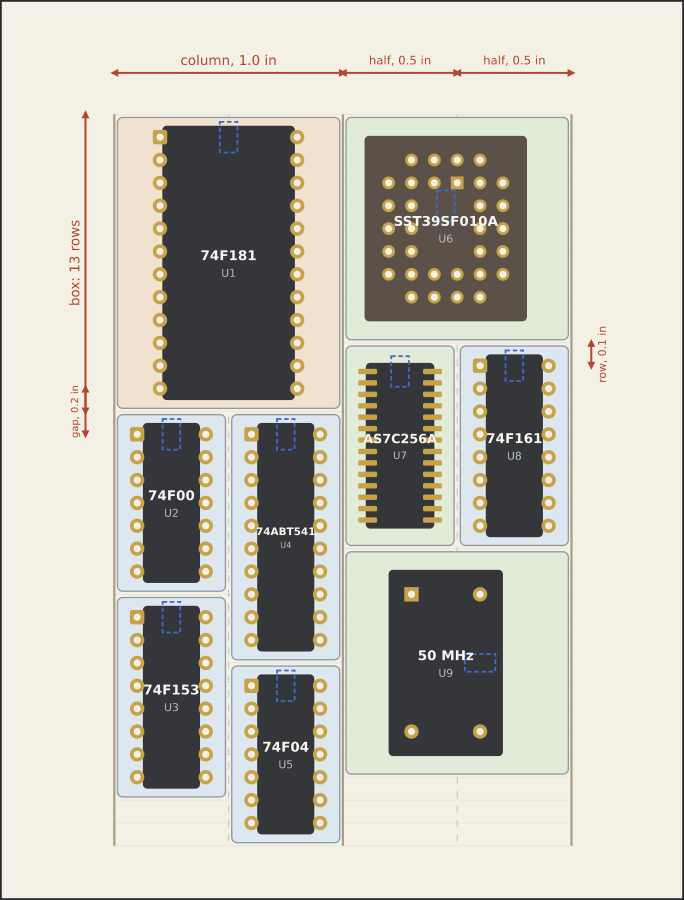
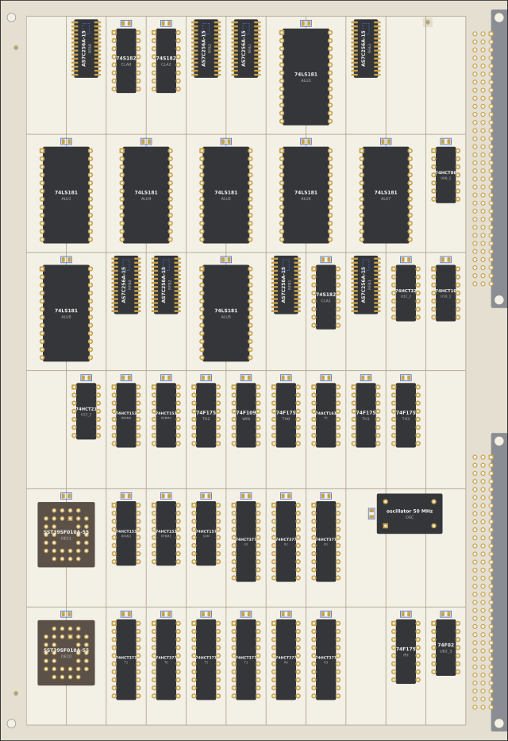
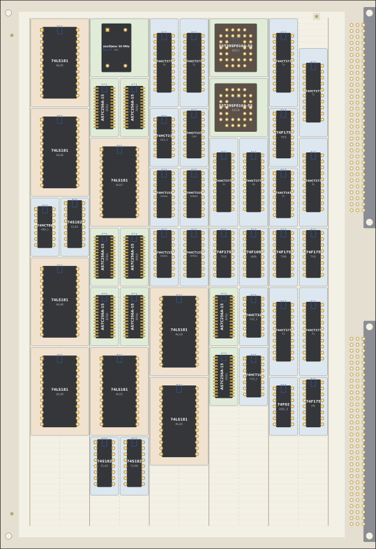
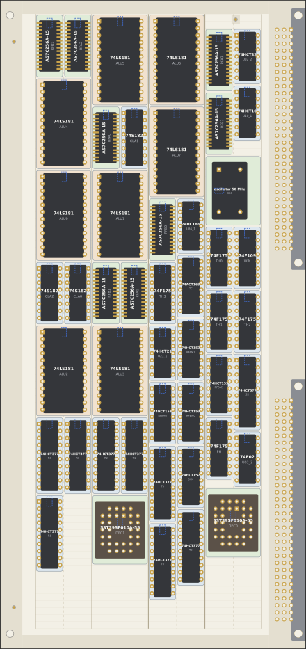
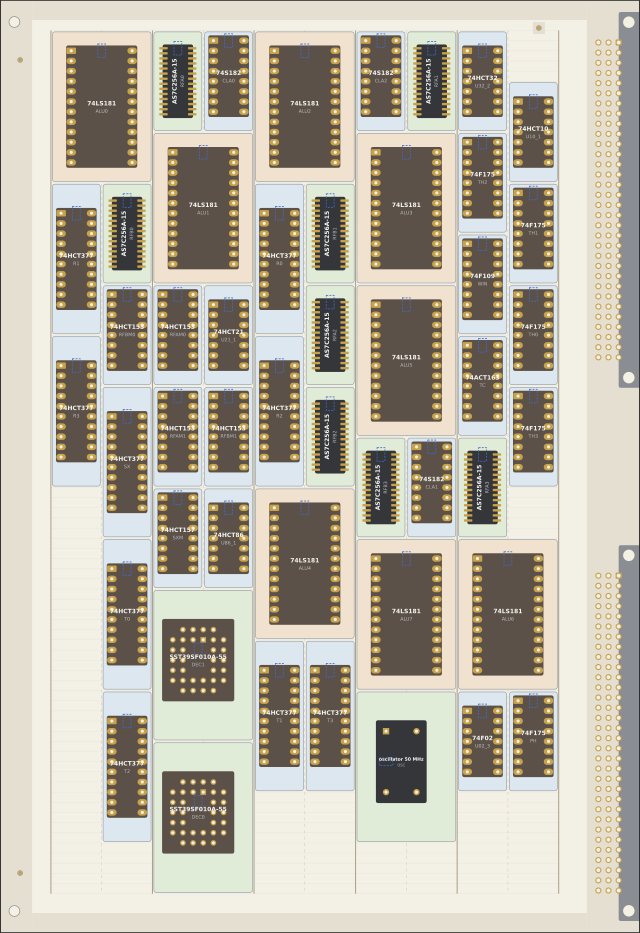

# RFC 0046: Placement on a grid of columns and half-columns

A new way to place a board's chips, for boards of DIPs soldered by hand.
The board is a grid: rows of 0.1 inch down it, and across it columns
that hold a 0.6 inch DIP or two half-columns of 0.3 inch DIPs side by
side. Every chip gets a box on the grid and sits in the middle of it,
with its pins on the 0.1 inch lattice. Connectors stay off the grid, as
exceptions. It would take the place of RFC 0026's R15 (the slots of
[RFC 0023](0023-rfc-pcb-flow.md)'s flow) for DIP boards.

The grid is Emily's proposal (2026-10-19): the rows, the columns and
half-columns, a full column holding two half-columns (one 74181, then
two stacks of narrow DIPs below it), a box for each chip with the chip in
its middle, the decoupling capacitors under the chips, the connectors as
exceptions. The rest (the exact box rules, the parameters, the placer)
is proposed here, from a prototype: [studies/pcb_columns](../studies/pcb_columns/README.md),
which places a 48-chip slice of the draft 1b CPU card on a double
Eurocard. It places only; nothing is routed. The numbers are in
[results.md](0046-rfc-column-grid/results.md), which
`heron pcb_columns report --write` generates with the figures.

*The slice with the defaults: 48 chips on 6U × 160 mm, 71% of the grid.
Solid lines are the columns, dashed ones the half-columns, the faint ones
the rows. Each chip's capacitor is under it (blue dashes), on the
bottom. The second column from the left is the case Emily described:
a 74181 across the column, then two stacks of narrow DIPs below it.*

## Summary

- **The grid** ([Part I](#part-i-specification)): rows of 0.1 inch;
  half-columns of 0.5 inch, columns of two; a box for each chip, the
  0.3 inch DIPs in half-columns and the 0.6 inch ones across a column,
  their pins on the 0.1 inch lattice; any other package in a half-column
  if its courtyard fits there, else a column. A DIP's box is its pins'
  rows and a gap of 0.2 inch to the next chip.
- **It looks like a board of the 1970s and costs no wire**
  ([9](#9-the-demonstration)): on the same card the slice takes 10.1 to
  11.7 m of wire, depending on the annealing's seed, against 11.2 m on
  RFC 0023's slots, in 71% of the card's grid, with the free room in one
  block at the bottom where the slots spread it between the chips.
- **The placer anneals each column's stack of boxes**
  ([11](#11-what-the-prototype-found)), which keeps the free room at the
  bottom by construction and finds shorter wire than annealing the
  boxes' positions for wire alone.
- **Four parameters** trade soldering against size
  ([10](#10-the-parameters)): the half-column's width (0.4, 0.5 or 0.6
  inch), the gap between chips down a column (2 or 3 rows), a module
  that rounds the boxes' heights so that they line up across the board
  (1 or 5 rows), and the DIPs' pads (round, long, socket). Between the
  tightest and the roomiest the slice needs a card from 110 to 180 mm
  deep.
- **Recommended defaults:** half-columns of 0.5 inch, a gap of 2 rows,
  round pads; the module **open** between 1 (Emily's rows as stated,
  tighter) and 5 (aligned, a quarter more area).
- **Open:** the module; the capacitors under through-hole chips, against
  RFC 0026's R17; whether to build it into the flow and route it next
  ([13](#13-open-questions)).

## Contents

Part I: Specification

1. [Terms](#1-terms)
2. [The grid on a board](#2-the-grid-on-a-board)
3. [Boxes](#3-boxes)
4. [A part in its box](#4-a-part-in-its-box)
5. [Placement](#5-placement)
6. [Exceptions](#6-exceptions)
7. [Decoupling](#7-decoupling)

Part II: Discussion

8. [Why: the slots](#8-why-the-slots)
9. [The demonstration](#9-the-demonstration)
10. [The parameters](#10-the-parameters)
11. [What the prototype found](#11-what-the-prototype-found)
12. [Limits and what's next](#12-limits-and-whats-next)
13. [Open questions](#13-open-questions)

## Part I: Specification

The rules are numbered C1 to C12 so that a board or a review can cite
them. Where they hold, they replace RFC 0026's R15 (arrangement) and its
R18's "beside the IC"; RFC 0026's other rules stand.

### 1. Terms

- **Row:** 0.1 inch (2.54 mm) down the board, the pitch of a DIP's pins.
- **Half-column:** `half` rows wide (default 5, 0.5 inch); holds a
  0.3 inch DIP.
- **Column:** two half-columns side by side; holds a 0.6 inch DIP, or
  two half-columns' parts.
- **Box:** a part's rectangle on the grid: one half-column or one column
  wide, a whole number of rows high.
- **Gap:** the rows from a DIP's last pin to the first pin of a DIP
  right below it (default 2, 0.2 inch).
- **Module:** box heights are whole modules of this many rows, and
  start on one (default 1: any row).
- **Lattice:** the points 0.1 inch apart from the grid's top left
  corner.

### 2. The grid on a board

- **C1 Size.** The grid is the most whole columns and whole modules of
  rows that fit in the region RFC 0026 leaves for parts (inside the
  guide strips, the front strip and the connectors' strip, R8 to R10).
- **C2 Place.** It is centred in that region, its top left corner moved
  to the nearest point of the board's own 0.1 inch grid (from the
  board's top left corner) that keeps it inside. KiCad's 0.1 inch grid
  then finds every pin.
- **C3 Orientation.** Columns run across the guided edges (top to bottom
  on a card whose connectors are on the right). Every part is turned so
  that its longer side runs down the column, pin 1 at the top left, as
  R15 has it.

### 3. Boxes

- **C4 Width.** A 0.3 inch DIP takes a half-column; a 0.6 inch DIP a
  column. Any other part takes a half-column if its courtyard (turned by
  C3) is no wider than a half-column, otherwise a column. A part wider
  than a column is an exception (C11).
- **C5 Height.** A DIP's box is its pins' rows less one, plus the gap: a
  DIP-14 6 + 2 = 8 rows by default, a DIP-24 13. Any other part's box is
  the fewest rows that hold its courtyard with the room a DIP-14's
  courtyard has in its own box. Then the height is rounded up to whole
  modules.
- **C6 Position.** A box starts on a row that is a multiple of the
  module, and a column's box on the column's left half-column: a 0.6 inch
  part never straddles two columns. Boxes don't overlap, and no box covers
  a blocked cell (C11).

The boxes of the packages in use, with the defaults (half-columns ×
rows; results.md has them under other parameters):

| Package | Box | Package | Box |
|---|---|---|---|
| DIP-8 | ½ × 5 | DIP-24 (0.6 in) | 1 × 13 |
| DIP-14 | ½ × 8 | DIP-28 (0.6 in) | 1 × 15 |
| DIP-16 | ½ × 9 | DIP-32 (0.6 in) | 1 × 17 |
| DIP-20 | ½ × 11 | DIP-40 (0.6 in) | 1 × 21 |
| DIP-24 (0.3 in) | ½ × 13 | PLCC-32 socket | 1 × 10 |
| SOJ-28 (300 mil) | ½ × 9 | oscillator, full can | 1 × 10 |
| SOJ-36 (400 mil) | ½ × 11 | oscillator, half can | 1 × 6 |
| SOIC-20 wide | ½ × 7 | TSSOP-16 | ½ × 4 |

### 4. A part in its box

- **C7 Middle.** A part sits in the middle of its box: its courtyard's
  middle on the box's.
- **C8 Lattice.** A through-hole part whose pins are whole rows apart
  (every DIP, the oscillator cans, a SIP) is moved from the middle to
  put its pins on the lattice: the nearer way first, half a row going up
  and to the left, the other way if the nearer one takes its courtyard
  out of its box. If neither keeps it in, its pins go on the 0.05 inch
  lattice instead. With the defaults every DIP is exactly centred on the
  0.1 inch lattice. In a half-column of 0.6 inch a 0.3 inch DIP sits
  0.05 inch left of the middle; in one of 0.4 inch it is centred, on the
  0.05 inch lattice ([10](#10-the-parameters)).
- **C9 Surface-mount parts** sit exactly in the middle, their pins
  wherever their pitch puts them.

### 5. Placement

- **C10 Free room.** The free cells gather at the bottom of the
  columns. A box has free cells above it only where it is a column's box
  below two half-columns of different heights, or where blocked cells
  (C11) hold it down.

The placer is not part of the specification; any that keeps C1 to C10
will do. The prototype's ([11](#11-what-the-prototype-found)) keeps the
wire short as RFC 0023's does, with the timing-critical nets weighted
(R20).

### 6. Exceptions

- **C11 Off the grid.** Connectors, mounting holes, fiducials and any
  part wider than a column keep their own places (RFC 0026's R9, R10,
  R14 and R21 for the first three). Every grid cell that their
  courtyards, with 1 mm round them, or a keep-out area touch is blocked.

### 7. Decoupling

- **C12 Under the chip.** Each chip's 100 nF capacitor (0805) is on the
  bottom, under the chip, on the line down its middle and turned along
  it, at the first spot from its VCC pin inwards where the capacitor's
  pads keep 1 mm from the chip's own: for a DIP, level with its VCC pin
  between the pin rows. It takes no room on the grid. For a
  through-hole chip this is against RFC 0026's R17 (no bottom-side part
  within 5 mm of a through-hole pad), which is about selective and wave
  soldering; question 2.

## Part II: Discussion

### 8. Why: the slots

RFC 0023's flow places a grid of slots, sized for SOIC and stretched to
fill the board (R15). For a DIP board it takes the slots at least
12.07 × 33 mm, enough for the tallest narrow DIP with room for the
router on four layers, and puts each chip at the top of its slot. On the
same slice and card that is 11 × 6 slots of 12.6 × 37.2 mm:

- **The slots aren't in the DIP's units.** Every slot is as tall as the
  tallest narrow DIP needs, so a DIP-14 in a 37 mm slot has 18 mm of
  nothing under it and a 74181 5 mm; the gaps between chips down a column
  change from chip to chip, and so do the routing channels.
- **Nothing is on a lattice.** The slots are stretched to fill the
  region, so their pitch is whatever divides it (12.59 mm here); pins
  of neighbouring chips are on no common grid.
- **The free room is everywhere,** spread over the card in the tall
  slots and the empty ones.
- **R17 moves the through-hole chips' capacitors beside them,** on top,
  which takes room in every slot.

The column grid works in the DIP's own units: a row is a pin, a
half-column a narrow DIP and its street, a box the chip and its gap.
The look follows from that: every pin of the board on one lattice,
chips of a kind the same distance apart, the streets between them
straight.

### 9. The demonstration

The slice is five sections of the draft 1b CPU card's own netlist
(studies/v1b_system): the ALU (eight 74LS181s, three 74S182s), the R
and T registers (74HCT377s), the register file (eight AS7C256A SRAMs, its
address multiplexers), the decode ROMs (two SST39SF010As) and the clock
generator (a 50 MHz can, 74F175s), 48 chips, with 166 nets between them
(the rest leave the slice). The packages are those of a board soldered
by hand: DIP where the part is made in DIP, the fast SRAMs in SOJ (no
fast SRAM is made in DIP), the flashes in PLCC sockets, the oscillator a
full can. The card is
a double Eurocard, 6U × 160 mm, with RFC 0026's mechanics (strips along
the guided edges and the front, the bracket holes, the fiducials) and the
CPU card's DIN 41612 connectors at the Eurocard positions.

| Variant | Parameters | Card | Grid used | Wire | Least pad gap |
|---|---|---|---:|---:|---:|
| default | half 0.5 in, gap 2, module 1, round pads | 6U × 160 | 71% | 11.7 m | 3.40 mm |
| aligned | module 5 | 6U × 160 | 84% | 11.6 m | 3.40 mm |
| tight | half 0.4 in | 6U × 110 | 89% | 10.0 m | 0.86 mm |
| roomy | gap 3, module 5, sockets with long pads | 6U × 160 | 88% | 12.2 m | 2.68 mm |
| RFC 0023's slots | at least 12.07 × 33 mm | 6U × 160 | | 11.2 m | |

(Wire: the half-perimeter length of the slice's nets, from the
annealing's first seed. Least pad gap: between two chips' pads, edge to
edge.)

- **No wire is lost.** The default grid places the slice in 10.1 to
  11.7 m of wire over four seeds (10.7 on average), against the slots'
  11.2 m on the same card, while it leaves 29% of the grid free in one
  block at the bottom. RFC 0023's slots spread the same slice over the
  whole card. Module 5 takes 11.5 to 12.2 m.
- **Smaller is shorter.** On the tight variant's 6U × 110 card the
  slice takes 10.0 m.
- **It packs.** The slice needs 130 mm of a 6U card with the defaults,
  110 mm with half-columns of 0.4 inch ([10](#10-the-parameters)).
- **Every check passes** on every variant: every chip in its box, its
  pins on its lattice, its courtyard inside the region, no courtyards
  overlapping, and with the defaults 3.40 mm between any two chips'
  pads, more than R16's 2.54.

*Aligned: the boxes' heights in whole modules of 5 rows (0.5 inch), so
that the grid is a lattice of half-inch squares and the boxes line up
across the board.*

*Tight: half-columns of 0.4 inch, on the least card that holds the
slice, 6U × 110 mm. Narrow DIPs' pins are 0.1 inch apart across the
columns.*

*Roomy: every DIP in a socket with long pads, 0.3 inch between chips
down the columns, modules of 5 rows; still on 6U × 160 mm.*

### 10. The parameters

Four numbers decide a board, and they are where soldering and size are
traded. Each with what it gives (results.md has the tables in full):

**The half-column's width** sets the street between columns, the room
for an iron and for tracks:

| Half-column | Narrow DIPs' pins apart | Pad gap, round / long pads | Tracks between, 0.15 / 0.25 mm rules | A narrow DIP in its box | Sockets side by side | The slice needs |
|---|---|---|---|---|---|---|
| 0.4 in | 0.1 in | 0.94 / 0.14 mm | 2 / 1 | centred, on the 0.05 in lattice | no | 6U × 110 |
| **0.5 in** | 0.2 in | 3.48 / 2.68 mm | 11 / 6 | centred | yes | 6U × 130 |
| 0.6 in | 0.3 in | 6.02 / 5.22 mm | 19 / 11 | 0.05 in left of the middle | yes | 6U × 150 |

- **0.5 inch** is the natural width: a 0.3 inch DIP sits exactly in the
  middle on the 0.1 inch lattice, 0.1 inch either side, and so does a
  0.6 inch DIP in a column of 1 inch, 0.2 inch either side. 3.5 mm
  between pads is easy to solder between and passes R16; eleven tracks
  pass between two columns at a common fab's rules.
- **0.4 inch** is the tightest that works, the classic dense TTL board:
  20% narrower, but 0.94 mm between pads (less than R16's 2.54), long
  pads collide, sockets don't fit side by side, two tracks between
  columns. The narrow DIP can't be centred on the 0.1 inch lattice
  without its courtyard leaving its box (the first try did that, and its
  pads overlapped a SOJ's beside it by 0.37 mm), so by C8 it goes on the
  0.05 inch one.
- **0.6 inch** gives room to route, at 15% more area; a 0.3 inch DIP
  sits 0.05 inch left of its box's middle, on the 0.1 inch lattice. 0.7
  inch would centre it again, at 40% more.

**The gap** sets the street across a column, between a chip's last pin
and the next chip's first:

| Gap | Pins apart | Pad gap | Tracks between, 0.15 / 0.25 mm | Courtyards apart, DIP / socket |
|---|---|---|---|---|
| **2 rows** | 0.2 in | 3.48 mm | 11 / 6 | 2.02 / 1.91 mm |
| 3 rows | 0.3 in | 6.02 mm | 19 / 11 | 4.56 / 4.45 mm |

- **2** gives the same street down the columns as across them with the
  default half-column: the board's pins are 0.2 inch apart wherever two
  chips meet. Sockets fit end to end with 1.9 mm between them.
- **3** gives a wider east-west channel, which a two-layer board, with
  its horizontal tracks on one side, may want. It costs a row per chip,
  about 10% of the height.
- **1** isn't allowed: two DIP bodies 0.1 inch apart overlap.

**The module** rounds each box's height up to whole modules, and starts
boxes on them:

- **1** (any row): the tightest; boxes of different heights stagger
  from column to column, so the streets across the columns don't line
  up.
- **5** (half an inch): the grid becomes a lattice of half-inch squares
  (with the default half-column), every box 1 to 5 of them high (2 or 3
  in the slice), and the boxes line up across the board, with them the
  east-west streets: long straight channels for the router. It costs a fifth to a quarter
  more area: the slice needs 6U × 160 against 130. A DIP-20 gets 15 rows
  for its 11, a DIP-16 10 for its 9.
- Any other module works; 5 suits the parts in use because DIP-14,
  DIP-16, SOJ-28, the PLCC socket and the can all fit 10 rows.

**The pads** choose the DIP footprints from KiCad's library:

- **round** (`DIP-14_W7.62mm`): ø1.6 mm, a 0.4 mm ring.
- **long** (`_LongPads`): 2.4 × 1.6 mm ovals, 0.8 mm of ring across the
  column, which RFC 0026 (its R25, still pending) found friendlier to
  solder by hand. They need half-columns of 0.5 inch: at 0.4 inch two
  pads are 0.14 mm apart.
- **socket** and **socket with long pads**: the same pads with the
  socket's courtyard, 10.66 mm wide; also need 0.5 inch.

So **for soldering by hand:** 0.5 inch half-columns, long pads, sockets
if wanted, a gap of 2 (3 for a two-layer board); **to fit a card:** 0.4
inch half-columns and module 1 each save 15 to 20% of the card's depth,
against 0.5 inch and module 5, at the cost of R16's spacing and of the
aligned look.
What fits, for the slice on a 6U card (results.md):

| Half-column | Gap | Module 1 | Module 5 |
|---|---|---:|---:|
| 0.4 in | 2 | 110 mm | 130 mm |
| 0.4 in | 3 | 120 mm | 130 mm |
| 0.5 in | 2 | 130 mm | 160 mm |
| 0.5 in | 3 | 130 mm | 160 mm |
| 0.6 in | 2 | 150 mm | 180 mm |
| 0.6 in | 3 | 150 mm | 180 mm |

### 11. What the prototype found

- **Non-DIP parts mostly fit a half-column.** The SOJ-28 SRAM's
  courtyard (9.80 mm) is as wide as a narrow DIP's (9.73), and a 400 mil
  SOJ-36 (an AS7C4096A's, 12.56 mm) just fits a half-column of 0.5 inch.
  The PLCC-32 socket (19 mm) and both oscillator cans (13.2 mm) need a
  column. C4 decides by the courtyard rather than by a list, so a new
  package finds its width by itself; with half-columns of 0.4 inch the
  SOJ-36 and a wide SOIC move to a column.
- **The placement is best searched as stacks.** The placer's state is
  each column's boxes in order from its top, each across the column or in
  its left or right half; stacking them gives every box its row, as high
  as the boxes above it allow. Its annealing swaps two boxes, moves one
  to another place in any column, or a narrow one to the other half, on
  the nets' half-perimeter length. Every state keeps C4 to C6 and C10,
  so the placement is legal and tidy throughout. The first try annealed
  the boxes' positions instead (a move puts a box on free cells, or
  swaps it with whatever exactly fills a box of its shape: a chip of the
  same size, two narrow chips side by side for a 0.6 inch one), with
  each hole costing wire, then let every box rise as far as it could:
  against the same annealing for wire alone, the rising cost up to a
  quarter of the wire. Annealing the stacks loses nothing to tidiness:
  at the same number of moves (60,000, about 12 s) it finds 10.7 m on
  average over four seeds, where annealing the positions for wire
  alone, the free room wherever it falls, finds 12.0 m (results.md).
- **Holes come from a column's box over two unequal half-columns.** A
  74181 below a stack of three DIP-14s on one side and two DIP-20s on the
  other waits under the longer stack, leaving cells free above the
  shorter. The stacks' annealing counts each such cell as 5 mm of wire;
  the slice's placements have 3 to 12 of them, out of about 250 free
  cells. Module 5, with fewer heights, leaves fewer.
- **The capacitors fit under every chip:** under a DIP level with its
  VCC pin, its pads 2.3 mm clear of the pin rows' (1.9 mm with long
  pads), and under the SOJ, the PLCC socket and the can.
  Nothing needs room beside a chip, so a box is just the chip and its
  streets.
- **The pins on the lattice** also make the board perfboard- and
  wire-wrap-compatible as drawn, and KiCad's default 0.05 inch grid finds
  every pin.

### 12. Limits and what's next

- **Not routed.** Whether the grid routes, and on how many layers, is
  the next question. The streets are regular, which should help a grid
  router; RFC 0023's finding that obstacles lined up into walls stopped
  its four-layer SMD grid applies here to the pin columns, which every
  east-west track must cross between pins (two tracks at 0.15 mm rules).
  Module 5's straight east-west streets are the counter to that.
- **In the study, not the flow.** The placer is `studies/pcb_columns`; it
  uses the flow's board model, footprints, global placement and checks.
  To use it for real boards it would move to `infra/pcb` beside
  `GridPlacer`, and the flow would take a `--columns` arrangement with
  these four parameters.
- **Heron Mini.** Report 0044 found that cpu2 doesn't fit A4 in DIP at
  any spacing tried. Its netlist is on RFC 0041's branch; once merged,
  the same placer can say what the column grid needs for it.
- **Silkscreen** (R27): the box's margin above each chip is a natural
  home for its reference, in the same place on every chip.
- **Placing by hand.** A designer may want to fix where a group goes (the
  ALU in the left column). Pinning a chip to a column, or to a place in
  its column's stack, is a small addition to the stacks' moves.
- **Footprints:** where KiCad isn't installed the study downloads the 53
  footprints it uses from KiCad's repository into `build/`, as RFC 0023's
  question 2 asks about for CI.

### 13. Open questions

For Emily:

1. **The grid:** C1 to C11 as the arrangement for DIP boards, in place
   of R15's slots?
2. **The capacitors under through-hole chips** (C12): against R17, which
   keeps the bottom clear near through-hole pads for selective and wave
   soldering. Recommended for boards soldered by hand, which is what
   the grid is for; R17 would then say so.
3. **The defaults:** half-columns of 0.5 inch, a gap of 2 rows, round
   pads (recommended)? Long pads by default, which R25 may want?
4. **The module (open):** 1, Emily's rows as stated and the tightest, or
   5, aligned boxes and straight streets for a quarter more area?
5. **Parts wider than a column** (a 0.9 inch DIP-64, a PLCC-68 socket):
   exceptions placed by hand (C11, recommended), or boxes of three or
   four half-columns?
6. **Next:** move the placer into `infra/pcb` and the flow, route the
   demonstration on two and four layers, and try Heron Mini's boards?
